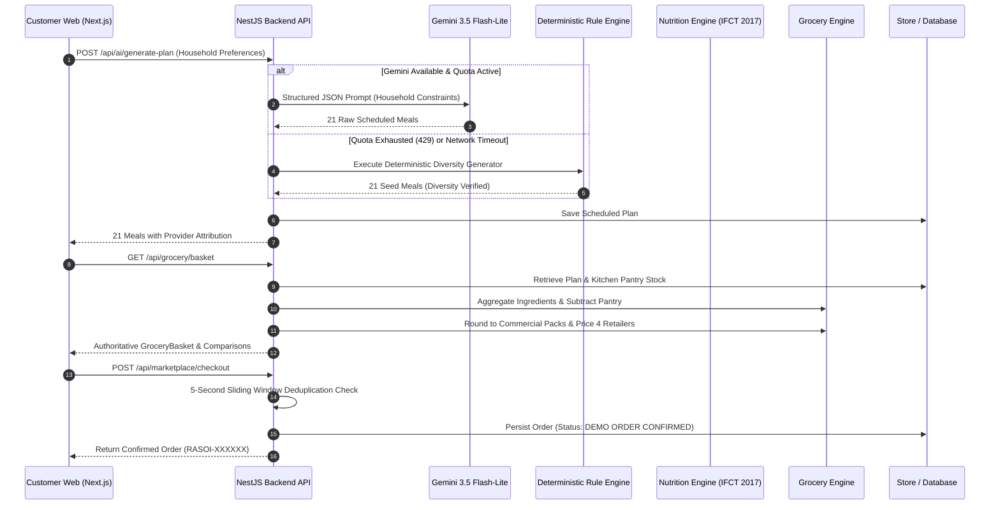

# 🏗️ RasoiIQ — Technology Architecture & System Design

> **Document Scope**: Engineering Architecture, Design Patterns, Data Pipelines & Security Boundaries  
> **Target Audience**: Technical Architects, Engineering Leads & Due Diligence Teams

---

## 1. Monorepo Architecture & Package Boundaries

RasoiIQ is structured as an npm workspaces monorepo separating customer applications, backend micro-services, and pure deterministic calculation packages:

```
rasoiiq/
├── apps/
│   ├── customer-web/           # Next.js 14 (App Router) client application
│   └── retailer-web/           # Partner management and stock dashboard
├── services/
│   └── api/                    # NestJS 10 backend core service
└── packages/
    ├── shared-types/           # Canonical TypeScript domain interfaces
    ├── nutrition-engine/       # Pure clinical IFCT 2017 calculation package
    └── grocery-engine/         # Pure grocery aggregation and scaling package
```

### Dependency Inversion Principle
- The UI layer (`apps/customer-web`) depends only on canonical types from `@rasoi/shared-types`.
- Core domain engines (`@rasoi/nutrition-engine` and `@rasoi/grocery-engine`) are zero-dependency pure TypeScript packages. They contain zero HTTP, UI, or database dependencies, making them trivially portable to React Native or edge workers.
- The backend API (`services/api`) orchestrates database queries, external AI providers, and calls the pure packages for all numerical transformations.

---

## 2. End-to-End Data Flow Pipeline



---

## 3. The 3-Tier AI Generation & Fallback Architecture

To ensure 100% operational uptime without paid enterprise AI subscriptions, RasoiIQ implements a 3-tier cascade:

```
┌─────────────────────────────────────────────────────────────┐
│                 AI MEAL PLAN GENERATION REQUEST             │
└──────────────────────────────┬──────────────────────────────┘
                               │
                               ▼
        ┌─────────────────────────────────────────────┐
        │  Tier 1: Google Gemini 3.5 Flash-Lite       │
        │  - Model: models/gemini-3.5-flash-lite      │
        │  - Strict JSON mode with system prompt      │
        └──────────────┬──────────────────────────────┘
                       │ Fails on 429 / 404 / 500 / Network Error
                       ▼
        ┌─────────────────────────────────────────────┐
        │  Tier 2: Google Gemini 3.1 Flash-Lite       │
        │  - Model: models/gemini-3.1-flash-lite      │
        │  - Secondary fallback candidate             │
        └──────────────┬──────────────────────────────┘
                       │ Fails or Daily Quota Exhausted
                       ▼
        ┌─────────────────────────────────────────────┐
        │  Tier 3: RasoiIQ Deterministic Engine       │
        │  - Rule-based algorithmic diversity solver  │
        │  - Recency penalties & protein rotation     │
        │  - 100% Offline / Zero API dependency       │
        └─────────────────────────────────────────────┘
```

### Rate-Limit State Management
When Google Gemini responds with HTTP 429:
1. The backend parses the `Retry-After` header or defaults to an exponential backoff duration.
2. The model status is recorded in an active cooldown state.
3. Subsequent requests within the cooldown window bypass Tier 1 immediately without wasting HTTP calls, instantly cascading to Tier 2 or Tier 3.

---

## 4. Deterministic Nutrition Engine Architecture (IFCT 2017)

### Nutritional Integrity Rules
1. **Zero Hallucination**: AI is prohibited from inventing nutrition numbers. All calculations derive from the Indian Food Composition Tables (IFCT 2017) published by ICMR-NIN.
2. **Serving Invariance**:
   $$\text{Nutrient Per Serving} = \frac{\sum_{i=1}^{n} (\text{Quantity}_i \times \text{NutrientDensity}_i)}{\text{Default Servings}}$$
   When the user scales recipe servings from 4 to 6:
   $$\text{Total Recipe Nutrients} = \text{Nutrient Per Serving} \times 6$$
   The per-serving values remain strictly unchanged.
3. **Rounding Precision & Tolerances**:
   Internal sums retain unrounded floating-point precision. Presentation rounding occurs strictly at the display boundary. The discrepancy between displayed rounded total and sum of rounded servings is mathematically bounded to $\le 2\text{ kcal}$.

---

## 5. Security & Isolation Architecture

### A. Role-Based Access Control (RBAC)
Implemented via a custom NestJS `RolesGuard` evaluating decoded JWT claims:
- `@Roles('CUSTOMER')`: Can access household plans, pantry, and checkout.
- `@Roles('RETAILER', 'ADMIN')`: Can access stock inventory (`/api/marketplace/retailer/:id/inventory`).
- `@Roles('ADMIN')`: Can access platform GMV metrics (`/api/marketplace/admin/metrics`).

### B. Secrets Isolation Boundary
- `GEMINI_API_KEY` is loaded only in the backend Node process via `.env`.
- Frontend code (`apps/customer-web`) has zero awareness of the Gemini API key. No `NEXT_PUBLIC_GEMINI_API_KEY` variable is permitted in build configurations.
- All AI calls are mediated through the backend controller with input sanitization.

### C. Idempotency & Duplicate Order Prevention
- To prevent accidental double orders during network latency, `MarketplaceService` computes a hash signature of `(retailerId, totalAmountInr, deliveryAddress, itemsCount)`.
- If an identical order arrives within a 5-second sliding window, the backend aborts with `400 Bad Request` (`Duplicate order submission detected`).

---
*Architectural Specifications Verified for Phase 2 MVP Demonstration.*
