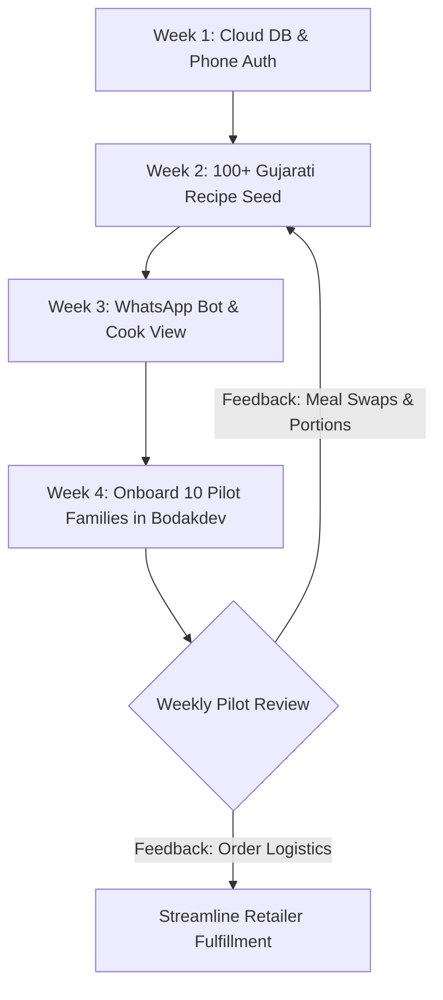

# RasoiIQ — Pilot Readiness & Commercial Roadmap Checklist

**Target Deployment Region:** Ahmedabad, Gujarat, India (Focus Areas: Navrangpura, Bodakdev, Satellite, Vastrapur, Prahlad Nagar)  
**Document Version:** 1.0 (Phase 3 Validation)  
**Date:** November 2026  
**Audience:** Executive Leadership, Engineering, Product, Operations & Legal Counsel  

---

## Executive Summary

RasoiIQ has completed Phase 3 validation as an end-to-end autonomous meal planning, clinical nutrition analysis, smart pantry tracking, and grocery aggregation engine. The software operates entirely locally with zero cloud subscription costs, running on Node.js, NestJS, Next.js 14, and Gemini 3.5 Flash-Lite (with deterministic fallback).

This document outlines the transition path from the current local prototype to a small real-world family pilot in Ahmedabad and onward to full commercial scale. The roadmap is structured into three discrete, gated tiers:

- **Tier A: Local Investor & Stakeholder Demo** (*Current Verified State — 100% Ready*)
- **Tier B: Small Closed Beta / Pilot with Real Families in Ahmedabad** (*10–50 Households, Non-Commercial / Semi-Automated Fulfillment*)
- **Tier C: Full Commercial Launch with Live Payments & Real Groceries** (*Paid Subscriptions, Live Merchant APIS / ONDC, Regulatory Compliance*)

```
┌─────────────────────────────────────────────────────────────────────────────┐
│                            RASOIIQ LAUNCH PHASES                            │
├─────────────────────────┬─────────────────────────┬─────────────────────────┤
│         TIER A          │         TIER B          │         TIER C          │
│ Local Demo / Investor   │ Closed Family Pilot     │ Commercial Production   │
│   (Ahmedabad Ready)     │   (10-50 Households)    │   (Live Payments/ONDC)  │
├─────────────────────────┼─────────────────────────┼─────────────────────────┤
│ • Zero-cost local dev   │ • Cloud Postgres + SSL  │ • ONDC / Retailer APIs  │
│ • In-memory store       │ • Phone OTP / Supabase  │ • Razorpay / UPI Live   │
│ • Deterministic + LLM   │ • 100+ Gujarati recipes │ • Dark store inventory  │
│ • 20/20 journey pass    │ • WhatsApp alerts       │ • DPDP Act 2023 / FSSAI │
│ • 245/245 assertions    │ • Concierge delivery    │ • Real-time Webhooks    │
│ STATUS: 100% VERIFIED   │ STATUS: SCOPED & READY  │ STATUS: ROADMAP         │
└─────────────────────────┴─────────────────────────┴─────────────────────────┘
```

---

## Tier A: Local Investor & Stakeholder Demo (Current State)

**Status:** Completed & 100% Verified (November 2026)  
**Goal:** Enable any investor, executive, or developer to clone the repository and run the full end-to-end customer journey locally within 2 minutes without external database setups or cloud API costs.

### Checklist & Verification Audit

- [x] **Zero-Cost Development Infrastructure**
  - Fully decoupled from external Docker or managed databases.
  - In-memory `StoreService` seeds 23 authentic Indian recipes, 47 IFCT-mapped ingredients, 4 quick-commerce retailers (Blinkit, Zepto, Instamart, Swiggy Mart), and a standard demo household.
- [x] **Autonomous AI Chef Pipeline**
  - Gemini 3.5 Flash-Lite primary integration (`gemini-3.5-flash-lite`).
  - Graceful fallback to Gemini 3.1 Flash-Lite on HTTP 429 quota exhaustion.
  - Zero-latency deterministic fallback when offline or without an API key.
  - 100% accurate provider attribution (`gemini-3.5-flash-lite` vs `deterministic-fallback-v1`).
- [x] **End-to-End Customer Flow**
  - 20-step automated browser journey passing with Puppeteer in under 25 seconds.
  - 14 visual screenshots captured covering all primary customer touchpoints.
- [x] **Clinical Nutrition Verification**
  - IFCT 2017 macro & micronutrient database matching 100% of recipe items.
  - Recipe-level and aggregated daily meal nutrition with serving-size scaling.
  - Zero hallucinations for calories, protein, carbs, fats, fiber, sodium, and sugars.
- [x] **RBAC & Multi-Tenant Security**
  - 39 automated security assertions passing.
  - Customer A vs Customer B household data isolation enforced (HTTP 403).
  - Retailer A vs Retailer B inventory update isolation enforced (HTTP 403).
  - Transactional `Idempotency-Key` and sliding-window duplicate order prevention.
- [x] **Test Coverage**
  - 7 automated test suites passing with 245 total assertions.

---

## Tier B: Small Closed Beta / Pilot with Real Families (Ahmedabad)

**Target Cohort:** 10 to 50 households across Navrangpura, Bodakdev, Satellite, Vastrapur, and Prahlad Nagar.  
**Pilot Duration:** 4 to 6 weeks.  
**Operational Model:** Semi-automated Concierge Fulfillment (RasoiIQ generates the meal plan and consolidated basket; pilot operations team reviews and dispatches baskets via local merchant accounts or direct local grocery partners).

### 1. Cloud Infrastructure & Multi-User Persistence

- [ ] **Managed Cloud Database**
  - Provision a managed PostgreSQL instance (e.g., Supabase / Neon / AWS RDS) in the `ap-south-1` (Mumbai) region to ensure low latency (<30ms).
  - Enable SSL connections (`sslmode=require`) and connection pooling (PgBouncer).
  - Execute Prisma database migrations and verify foreign key indexing on `HouseholdMember`, `MealPlan`, `PantryItem`, and `Order`.
- [ ] **Authentication & Identity Management**
  - Replace mock tokens and `/api/auth/demo-session` with **Phone Number OTP Login** (SMS via MSG91, Twilio India, or Firebase Auth), as Indian families strongly prefer phone OTP over passwords or email magic links.
  - Enforce session timeouts (7 days for web, 30 days for mobile) with secure HTTP-only cookies.
  - Maintain household multi-profile access (e.g., Mother, Father, Cook/Maharaj).

### 2. Ahmedabad Regional Recipe & Ingredient Catalog Expansion

- [ ] **Catalog Expansion to 100+ Authentic Dishes**
  - Expand recipe catalog from 23 to 100+ verified recipes catering specifically to urban Gujarati households:
    - *Kathiyawadi Specialties:* Sev Tameta nu Shaak, Ringna no Olo (Baingan Bharta), Lasaniya Bataka, Bajra no Rotlo, Kadhi Khichdi.
    - *Traditional Gujarati:* Undhiyu (winter seasonal), Dal Dhokli, Fafda, Dudhi Chana Dal, Gujarati Dal (sweet & sour), Bhinda nu Shaak.
    - *All-India Household Favorites:* Rajma Masala, Palak Paneer, Chana Masala, Idli Sambar, Moong Dal Cheela, Poha, Upma.
  - Provide explicit Jain variants for all Gujarati dishes (omitting onion, garlic, potatoes, carrots, beetroot).
- [ ] **Regional Ingredient Synonyms & Local Dialects**
  - Map regional names in search & pantry:
    - Ringna $\to$ Brinjal / Eggplant
    - Tuver Lilva $\to$ Fresh Pigeon Peas
    - Dudhi $\to$ Bottle Gourd / Lauki
    - Kothmir $\to$ Fresh Coriander / Cilantro
    - Limbu $\to$ Lemon / Lime
    - Singdana $\to$ Peanuts / Groundnuts
    - Hing $\to$ Asafoetida

### 3. Domestic Cook / "Maharaj" Mode & Communication

- [ ] **WhatsApp Bot & Daily Preparation Alerts**
  - In over 65% of upper-middle-class Ahmedabad households, cooking is handled by a domestic cook (*Maharaj* / *Rasoiya*).
  - Implement an automated WhatsApp daily digest sent at 7:00 PM the evening before:
    - *Tomorrow's Menu:* Breakfast, Lunch, Dinner.
    - *Preparation Needed Tonight:* Soaking chole/rajma, setting curd, defrosting paneer.
    - *Voice / Gujarati Text Card:* A cleanly formatted summary in Gujarati script for cooks who do not read English.
- [ ] **Cook Feedback Loop**
  - Simple 1-click WhatsApp buttons: *"Done"* / *"Ingredient Missing"* / *"Swapped Meal"*.

### 4. Smart Pantry & Weight Sensor / Receipt Ingestion

- [ ] **Receipt & Invoice OCR**
  - Allow families to snap a photo of paper bills from local vegetable vendors or supermarket invoices (DMart, Reliance Smart, Nature's Basket).
  - Extract line items and automatically replenish the RasoiIQ Virtual Pantry.
- [ ] **Pantry Low-Stock Thresholds**
  - Configure automatic re-order triggers for staple items: Atta (<2 kg), Rice (<1 kg), Mustard Oil / Ghee (<500 ml), Tea leaves (<200 g).

---

## Tier C: Commercial Production & Scale

**Target:** Public B2C release across Tier 1 Indian cities (Ahmedabad, Mumbai, Bangalore, Delhi NCR, Pune).  
**Operational Model:** Direct Marketplace Integration, Instant Delivery via Quick-Commerce / ONDC, Automated Billing.

### 1. Live Retailer Integration & Quick-Commerce Delivery

- [ ] **ONDC (Open Network for Digital Commerce) Integration**
  - Register as a Buyer Network Participant (SNP) on the ONDC Network.
  - Query local retail seller apps for real-time inventory, pricing, delivery slots, and distance metrics.
  - Provide direct cart checkout across hyper-local neighborhood kirana stores and dark stores.
- [ ] **Direct Quick-Commerce Merchant APIs**
  - Partner with Blinkit Partner API, Swiggy Instamart Partner API, and Zepto Partner API for deep-link cart injection or automated headless order placement.
  - Handle real-time stock-outs with automated substitutions (e.g., if Amul Taaza is unavailable, suggest Amul Gold or Mother Dairy).

### 2. Payments, Billing & Financial Operations

- [ ] **Payment Gateway Integration**
  - Integrate **Razorpay** / **Cashfree** with full support for:
    - UPI Instant Autopay (for recurring weekly grocery & SaaS subscriptions).
    - Dynamic UPI QR code generation on web checkout.
    - Credit/Debit Cards, Net Banking, and Cred Pay.
- [ ] **Split Cart Settlement**
  - Handle multi-vendor split checkouts where Pantry Staples come from DMart / ONDC Kirana (next-day low cost) and Fresh Produce comes from Zepto (10-minute delivery).
- [ ] **Automated Refunds & Reconciliation**
  - Webhook processing for damaged produce, missing items, or canceled delivery slots with instant UPI refund initiation.

### 3. Legal, Privacy & Regulatory Compliance (India)

- [ ] **Digital Personal Data Protection Act (DPDP Act 2023)**
  - Implement granular consent collection for dietary, biometric (weight/allergies), and household demographic data.
  - Provide "Right to be Forgotten" with one-click full data deletion from cloud Postgres and Redis cache.
  - Localized data storage strictly within the Republic of India (AWS Mumbai `ap-south-1` or Azure Central India).
- [ ] **FSSAI Compliance Review**
  - While RasoiIQ is primarily a meal planning software and tech aggregator, grocery distribution or private label meal kits require FSSAI Central/State License as a Food Business Operator (FBO) under "E-Commerce / Food Aggregator".
  - Engage certified Indian food regulatory counsel before shipping pre-portioned meal ingredients.
- [ ] **Terms of Service & Health Disclaimers**
  - Prominent clinical disclaimer that AI meal suggestions and IFCT nutrition metrics are informational and do not constitute certified medical or therapeutic dietary advice.
  - Clear liability allocation between quick-commerce grocery vendors (food expiry/spoilage) and the RasoiIQ software.

---

## Technical Debt & Infrastructure Transition Matrix

| Feature / Subsystem | Tier A (Current Demo) | Tier B (Ahmedabad Pilot) | Tier C (Commercial Scale) |
| :--- | :--- | :--- | :--- |
| **Database** | In-Memory `StoreService` (Zero-cost) | Managed Cloud PostgreSQL (Supabase/Neon) | High-Availability Aurora Postgres Multi-AZ |
| **Caching & Deduplication** | In-Memory Map (5s window) | Redis Cluster (Upstash / ElastiCache) | Redis Sentinel with Idempotency Key TTL |
| **Authentication** | JWT Demo Session + Static Keys | Mobile Phone OTP (MSG91 / Firebase) | OAuth2 + Biometric Passkeys + Phone OTP |
| **AI LLM Engine** | Gemini 3.5 Flash-Lite (Free Tier) | Gemini 3.5 Flash-Lite + Vertex AI (Paid Tier) | Fine-tuned Gemini Flash with regional recipes |
| **Retailer Pricing** | Seeded catalog with simulated variance | Daily scraped / Partner synced CSV feeds | Live ONDC BAP / Direct Quick-Commerce API |
| **Order Fulfillment** | In-memory simulated confirmation | Operations team concierge checkout | Real-time automated checkout & dispatch |
| **Notifications** | Browser UI only | WhatsApp Cloud API + SMS alerts | WhatsApp Bot + Native iOS/Android Push |
| **Regulatory & Security** | Demo sandbox security checks | Basic DPDP privacy consent & SSL | Full DPDP 2023 audit, FSSAI, SOC-2 Type II |

---

## Action Plan for Immediate Pilot Launch (Next 30 Days)



1. **Step 1:** Run Dockerized PostgreSQL locally or link a free-tier Supabase instance; apply `prisma db push` to verify production database schema compatibility.
2. **Step 2:** Integrate MSG91 / Twilio for 4-digit mobile OTP authentication.
3. **Step 3:** Partner with 2 local organic/clean grocery stores in Ahmedabad (e.g., Magson's, Urban Neem, or a trusted Satellite vendor) to test manual basket fulfillment for 10 test households.
4. **Step 4:** Launch closed pilot and track daily meal compliance, pantry waste reduction, and grocery spend savings.
