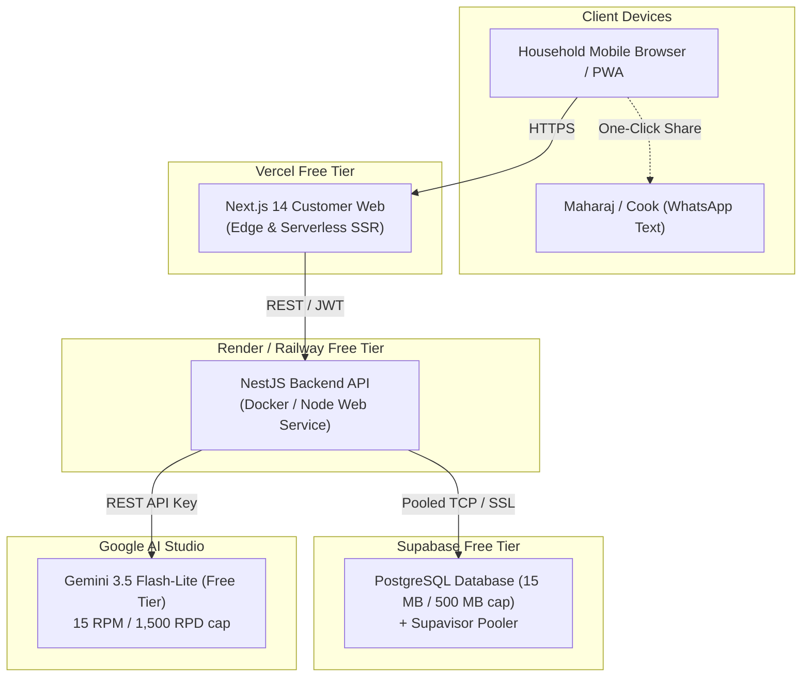

# RasoiIQ — Zero-Cost Pilot Deployment Assessment & Infrastructure Plan

## Executive Summary
This document provides a realistic, objective evaluation of database and backend hosting options for running a small, controlled 3–5 household pilot of RasoiIQ for 4–6 weeks at strict **zero financial cost ($0 / ₹0)**.

---

## 1. Pilot Resource Requirements (3–5 Households, 6 Weeks)

| Parameter | Estimated Usage per Household | 5 Households Total (6 Weeks) |
| :--- | :--- | :--- |
| **Meal Plans** | 6 weekly plans (126 meals) | 30 plans (630 meal plan items) |
| **Pantry Stock** | 25 tracked staple ingredients | 125 pantry records |
| **Grocery Orders** | 1–2 orders per week (6–12 orders) | 30–60 orders (~600 order items) |
| **Relational Database Rows** | ~200 rows | ~2,000–3,500 total rows |
| **Database Storage Footprint** | ~500 KB | **< 15 MB** (including indexes) |
| **API Requests** | ~150 requests/week | ~4,500 total requests |
| **AI Meal Plan Generations** | 1–2 generations/week | 30–60 Gemini calls (well within 15 RPM / 1,500 RPD free tier) |

---

## 2. Free-Tier Cloud Database Evaluation

### Option 1: Supabase Free Tier (Recommended for Hosted Pilot)
- **Database Engine**: PostgreSQL 15.x / 16.x.
- **Free Tier Allowance**: 500 MB database storage, 2 active projects, 50,000 monthly active users.
- **Connection Pooling**: Built-in Supavisor connection pooling (port 6543 / 5432).
- **SSL / Security**: Enforced SSL (`sslmode=require`), row-level security (RLS) support.
- **Sleep / Inactivity Policy**: Projects pause after **7 days of complete inactivity**.
  - *Mitigation for Pilot*: A weekly cron ping or automated test keep-alive script prevents sleep.
- **Zero-Cost Guarantee**: No credit card required at sign-up; hard-capped at free limits without automatic overage charges.
- **Suitability Rating**: **EXCELLENT (9.5/10)**.

### Option 2: Neon Serverless PostgreSQL Free Tier
- **Database Engine**: PostgreSQL 16.x.
- **Free Tier Allowance**: 0.5 GB storage, 1 project, shared compute.
- **Scale-to-Zero Behavior**: Computes scale to zero after 5 minutes of inactivity. First query experiences a **1.5s–3s cold start latency**.
- **Connection Pooling**: Native PgBouncer connection string provided.
- **Zero-Cost Guarantee**: Free forever tier without credit card requirement.
- **Suitability Rating**: **GOOD (8.0/10)** — cold start latency might cause a 2s delay on the first morning request.

### Option 3: Local Self-Hosted PostgreSQL (Current Verification Environment)
- **Database Engine**: PostgreSQL 18.0 inside WSL2 Ubuntu on developer machine.
- **Cost**: $0 / ₹0 guaranteed.
- **Limitations**: Only accessible on local network or via tunnels (e.g. Cloudflare Tunnels / ngrok); machine must remain powered on.
- **Suitability Rating**: **IDEAL for Founder + 1 Co-located Household Demo (10/10)**; not suitable for external remote households without a tunnel.

---

## 3. Zero-Cost Full Stack Deployment Topology

---

## 4. Pilot Security & Risk Checklist Before External Access

1. **Environment Secrets**: Ensure `JWT_SECRET` is set to a cryptographically random 64-character hex string in cloud environment variables.
2. **Disable Demo Sessions**: Set `ALLOW_DEMO_AUTH=false` and `NODE_ENV=production` when deploying externally so arbitrary users cannot trigger `/api/auth/demo-session`.
3. **SSL Enforcement**: Set `DATABASE_URL=...?sslmode=require` in backend environment configuration.
4. **Data Privacy**: Ensure pilot household participants understand meal logs and orders are stored in a secured PostgreSQL database for pilot study analysis.
5. **Concierge Operational Playbook**: Establish clear WhatsApp support communication for manual concierge fulfillment during the pilot.
