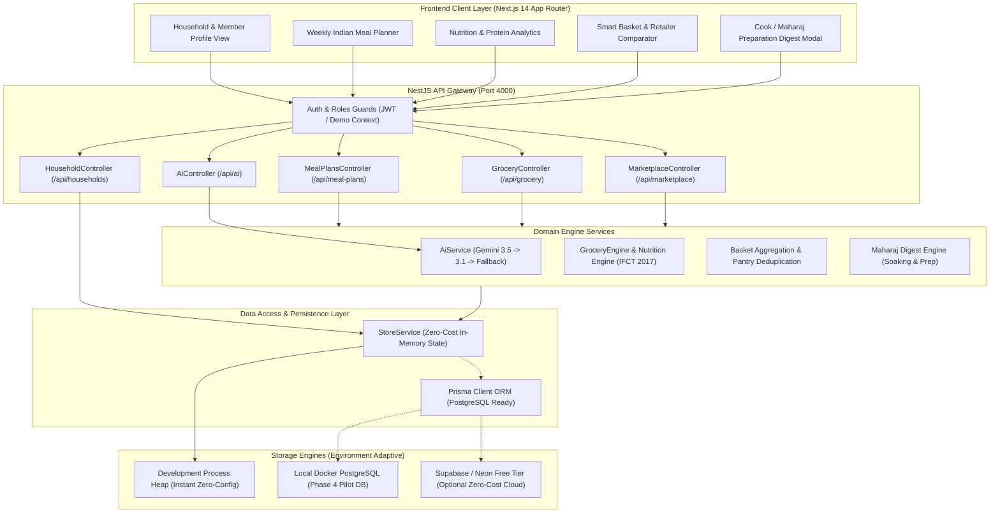

# RasoiIQ Phase 4: Architecture Proposal & Modular Boundaries

## 1. Executive Summary & Objective

RasoiIQ is transitioning from a single-tenant local prototype to a multi-household validation pilot platform. The core goal of Phase 4 is to establish strict data isolation, persistent storage readiness, domestic cook (*Maharaj*) integration, and authentic regional culinary intelligence (specifically Gujarati and Kathiyawadi cuisine for Western Indian pilot households) while strictly preserving our **Zero-Cost Development Principle**.

At no point in this architecture are paid SaaS subscriptions, cloud data pipelines, paid AI endpoints, or proprietary vendor locks required. The entire stack remains 100% executable locally, demo-ready in seconds, and completely functional with deterministic fallbacks when internet access or third-party APIs are disconnected.

---

## 2. Core System Architecture

---

## 3. Modular Boundaries & Domain Separation

The application is structured into decoupled monorepo packages to maintain strict separation of concerns:

| Package / Module | Responsibility | Key Public APIs / Interfaces | Dependencies |
| :--- | :--- | :--- | :--- |
| `packages/shared-types` | Authoritative TypeScript contracts, enums, data transfer schemas. | `Household`, `MealPlanItem`, `Recipe`, `MaharajPreparationSummary`, `ItemFulfillmentStatus`. | None (Zero dependency). |
| `packages/validation` | Runtime Zod schemas verifying data boundaries and payloads. | `HouseholdSchema`, `MealPlanItemSchema`, `IndianCuisinesEnum`, `AIPlanResponseSchema`. | `zod`. |
| `packages/grocery-engine` | Pure mathematical & scientific computation engines. | `calculateRecipeNutrition()`, `calculateWeeklyNutritionAnalytics()`, `aggregateGroceryRequirements()`. | `@rasoi/shared-types`. |
| `packages/database` | Seed data fixtures, regional recipes, IFCT nutrition mappings, and Prisma schemas. | `SEED_RECIPES`, `SEED_INGREDIENTS`, `SEED_PRODUCT_VARIANTS`, `SEED_RETAILERS`. | `@prisma/client`. |
| `services/api` | NestJS backend exposing RESTful endpoints, JWT auth, RBAC, and AI provider routing. | Auth, Household, MealPlans, Grocery, Marketplace, and AI controllers. | `@nestjs/*`, `jsonwebtoken`. |
| `apps/customer-web` | Next.js 14 App Router customer dashboard, meal planner, basket, and cook digest UI. | Client components, Tailwind CSS styling, Lucide icons, responsive layout. | React 18, Next.js 14, Tailwind. |

---

## 4. Multi-Tenant Household Context Resolution

In Phase 1–3, the application utilized single-tenant demo shortcuts (`'hh-sharma-family'` hardcoded in controller handlers). Phase 4 introduces **Declarative Household Context Resolution**:

1. **Authentication Token Payload**:
   The JWT claims include `userId`, `email`, `role` (`CUSTOMER` | `RETAILER` | `ADMIN`), and `householdId`.
2. **Context Resolution Pipe (`resolveHouseholdId`)**:
   - If an unauthenticated request arrives in local development mode, it gracefully defaults to the active demo household (`hh-sharma-family`), preserving demo scripts and rapid developer ergonomics.
   - If an authenticated request arrives with role `CUSTOMER`, it guarantees that `user.householdId === requestedHouseholdId`. Any mismatch immediately throws `403 Forbidden`.
   - If a request arrives with role `RETAILER`, customer meal plans and pantry lists are strictly blocked with `403 Forbidden`.
   - If a request arrives with role `ADMIN`, cross-household access is permitted for platform monitoring and customer support.

---

## 5. Cook / Maharaj Domain Integration

In traditional Indian households, home cooking is often executed by a domestic cook (*Maharaj*). The operational bottleneck is never recipe inspiration; it is **overnight legume soaking** and **advance morning preparation**.

The Phase 4 architecture elevates the *Maharaj Digest* to a first-class domain entity:
- **`MaharajPreparationSummary`**:
  - `targetDay`: The calendar day being planned (e.g. tomorrow).
  - `plannedMeals`: Target day recipes with meal slots, Hindi/Gujarati titles, cooking durations, and servings.
  - `overnightSoaking`: Automatically filtered legumes and pulses (`Kabuli Chana`, `Rajma`, `Toor Dal`, `Urad Dal`, `Chana Dal`, `Moong Dal`) with soaking hours and prep notes.
  - `advancePreparation`: Dough kneading tasks (e.g., Thepla or Rotlo dough resting), vegetable marination, and spice pounding.
  - `householdDietaryRestrictions`: Explicit alerts for cook staff regarding family member restrictions (e.g., "Dad eats strictly Jain—no onion, garlic, or potatoes; Rohan is eggetarian").

---

## 6. Zero-Cost Technology Decision Matrix

| Concern | Enterprise Production (Future) | Phase 4 Zero-Cost Pilot (Present) | Justification |
| :--- | :--- | :--- | :--- |
| **Authentication** | Twilio / Firebase Phone SMS OTP | Secure Seeded JWT Demo Auth & Cookie Sessions | Zero recurring SMS costs; eliminates carrier verification friction for local testers. |
| **Primary AI** | Gemini 1.5 Pro / GPT-4o Enterprise | Google Gemini 3.5 Flash-Lite (Free Tier) | Zero API cost; generous free quota; sub-second latency for Indian recipe reasoning. |
| **Fallback AI** | Anthropic Claude 3.5 Sonnet | RasoiIQ Deterministic Engine (Algorithmic) | 100% offline availability; zero quota dependency; mathematically verified nutrition. |
| **Database** | AWS RDS Aurora PostgreSQL | In-Memory Heap + Local Docker PostgreSQL | Zero cloud hosting bills; runs completely offline on developer hardware. |
| **Cache / Queue** | AWS ElastiCache Redis | In-Memory Sliding Window Maps | Zero memory overhead; zero network hop latency for local pilots. |
| **Grocery Sync** | Scraping / Unofficial Dark Store APIs | Curated Seed Catalogs & Concierge Fulfillment | 100% legal; zero risk of IP bans; transparent sample data disclosures for users. |
