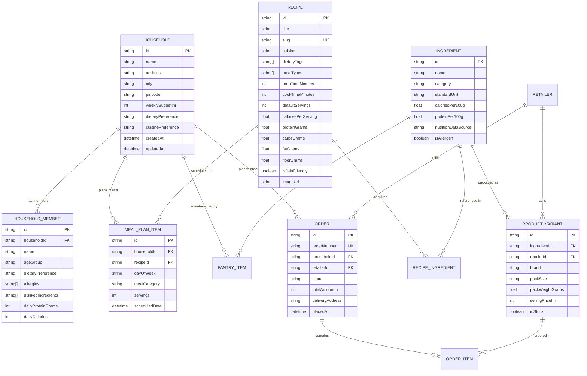

# RasoiIQ Phase 4: Database Design & Persistence Architecture

## 1. Overview & Strategy

RasoiIQ employs a dual-mode persistence architecture:
1. **Zero-Cost In-Memory Store (`StoreService`)**: An ultra-lightweight, zero-config in-memory state engine running directly inside the NestJS process heap. It enables instantaneous setup for demos, unit tests, and offline development with 0 external daemon requirements.
2. **Prisma ORM with PostgreSQL**: A robust relational database schema designed for multi-tenant pilot deployments. It supports ACID transactions, foreign-key cascade integrity, multi-household isolation, and relational query optimization.

---

## 2. Relational Entity Relationship Diagram



---

## 3. Prisma Schema Definition (`packages/database/prisma/schema.prisma`)

```prisma
datasource db {
  provider = "postgresql"
  url      = env("DATABASE_URL")
}

generator client {
  provider = "prisma-client-js"
}

enum DietaryPreference {
  VEGETARIAN
  NON_VEGETARIAN
  EGGETARIAN
  VEGAN
  JAIN
}

enum MealCategory {
  breakfast
  lunch
  dinner
  snack
}

enum DayOfWeek {
  monday
  tuesday
  wednesday
  thursday
  friday
  saturday
  sunday
}

model Household {
  id                String            @id @default(uuid())
  name              String
  address           String
  city              String            @default("Ahmedabad")
  pincode           String            @default("380054")
  weeklyBudgetInr   Int               @default(3500)
  dietaryPreference DietaryPreference @default(VEGETARIAN)
  cuisinePreference String            @default("ALL_INDIAN")
  createdAt         DateTime          @default(now())
  updatedAt         DateTime          @updatedAt

  members           HouseholdMember[]
  mealPlanItems     MealPlanItem[]
  pantryItems       PantryItem[]
  orders            Order[]

  @@map("households")
}

model HouseholdMember {
  id                  String            @id @default(uuid())
  householdId         String
  household           Household         @relation(fields: [householdId], references: [id], onDelete: Cascade)
  name                String
  ageGroup            String            @default("adult")
  dietaryPreference   DietaryPreference @default(VEGETARIAN)
  allergies           String[]          @default([])
  dislikedIngredients String[]          @default([])
  dailyProteinGrams   Int?
  dailyCalories       Int?

  @@index([householdId])
  @@map("household_members")
}

model Recipe {
  id                 String         @id
  title              String
  slug               String         @unique
  description        String
  cuisine            String
  dietaryTags        String[]
  mealTypes          String[]
  prepTimeMinutes    Int
  cookTimeMinutes    Int
  defaultServings    Int            @default(4)
  difficulty         String         @default("Medium")
  proteinSource      String?
  caloriesPerServing Float
  proteinGrams       Float
  carbsGrams         Float
  fatGrams           Float
  fiberGrams         Float
  sugarGrams         Float?
  sodiumMg           Float?
  isJainFriendly     Boolean        @default(false)
  imageUrl           String
  estimatedCostInr   Int            @default(120)

  ingredients        RecipeIngredient[]
  mealPlanItems      MealPlanItem[]

  @@map("recipes")
}

model Ingredient {
  id                  String             @id
  name                String
  category            String
  defaultUnit         String
  caloriesPer100g     Float
  proteinPer100g      Float
  carbsPer100g        Float
  fatPer100g          Float
  fiberPer100g        Float
  nutritionSource     String             @default("IFCT_2017")
  isJainFriendly      Boolean            @default(true)
  allergens           String[]           @default([])

  recipeIngredients   RecipeIngredient[]
  productVariants     ProductVariant[]
  pantryItems         PantryItem[]

  @@map("ingredients")
}

model RecipeIngredient {
  id           String     @id @default(uuid())
  recipeId     String
  recipe       Recipe     @relation(fields: [recipeId], references: [id], onDelete: Cascade)
  ingredientId String
  ingredient   Ingredient @relation(fields: [ingredientId], references: [id])
  quantity     Float
  unit         String
  notes        String?

  @@unique([recipeId, ingredientId])
  @@index([recipeId])
  @@index([ingredientId])
  @@map("recipe_ingredients")
}

model MealPlanItem {
  id           String       @id @default(uuid())
  householdId  String
  household    Household    @relation(fields: [householdId], references: [id], onDelete: Cascade)
  recipeId     String
  recipe       Recipe       @relation(fields: [recipeId], references: [id])
  dayOfWeek    DayOfWeek
  mealCategory MealCategory
  servings     Int          @default(4)
  createdAt    DateTime     @default(now())

  @@index([householdId, dayOfWeek])
  @@map("meal_plan_items")
}

model PantryItem {
  id           String     @id @default(uuid())
  householdId  String
  household    Household  @relation(fields: [householdId], references: [id], onDelete: Cascade)
  ingredientId String
  ingredient   Ingredient @relation(fields: [ingredientId], references: [id])
  quantityGrams Float
  updatedAt    DateTime   @updatedAt

  @@unique([householdId, ingredientId])
  @@index([householdId])
  @@map("pantry_items")
}

model Retailer {
  id                   String           @id
  name                 String
  slug                 String           @unique
  logoUrl              String
  deliveryFeeInr       Int              @default(0)
  deliveryTimeEstimate String
  serviceType          String

  productVariants      ProductVariant[]
  orders               Order[]

  @@map("retailers")
}

model ProductVariant {
  id               String       @id
  ingredientId     String
  ingredient       Ingredient   @relation(fields: [ingredientId], references: [id])
  retailerId       String
  retailer         Retailer     @relation(fields: [retailerId], references: [id])
  brand            String
  packSize         String
  packWeightGrams  Float
  sellingPriceInr  Int
  mrpInr           Int
  inStock          Boolean      @default(true)

  orderItems       OrderItem[]

  @@index([ingredientId])
  @@index([retailerId])
  @@map("product_variants")
}

model Order {
  id                   String      @id
  orderNumber          String      @unique
  householdId          String
  household            Household   @relation(fields: [householdId], references: [id])
  retailerId           String
  retailer             Retailer    @relation(fields: [retailerId], references: [id])
  status               String      @default("DEMO ORDER CONFIRMED")
  subtotalInr          Int
  deliveryFeeInr       Int         @default(0)
  totalAmountInr       Int
  deliveryAddress      String
  placedAt             DateTime    @default(now())

  items                OrderItem[]

  @@index([householdId])
  @@map("orders")
}

model OrderItem {
  id               String         @id @default(uuid())
  orderId          String
  order            Order          @relation(fields: [orderId], references: [id], onDelete: Cascade)
  productVariantId String
  productVariant   ProductVariant @relation(fields: [productVariantId], references: [id])
  productName      String
  quantity         Int
  priceInr         Int
  totalItemPriceInr Int
  itemStatus       String         @default("AVAILABLE")
  substitutionNotes String?

  @@index([orderId])
  @@map("order_items")
}
```

---

## 4. Seed Data Synchronization

To ensure continuous parity between the in-memory engine and PostgreSQL:
1. `packages/database/src/seed-data.ts` remains the **Single Source of Truth** for recipes, nutritional profiles, and product mappings.
2. The seed script (`packages/database/prisma/seed.ts`) reads directly from `SEED_RECIPES`, `SEED_INGREDIENTS`, and `SEED_PRODUCT_VARIANTS` and upserts them via Prisma transactions:
   ```bash
   npx prisma migrate dev --name init_phase4
   npx prisma db seed
   ```
3. If PostgreSQL is absent or unavailable (`DATABASE_URL` unset), `StoreService` automatically boots in in-memory mode, guaranteeing zero broken builds across local environments.
