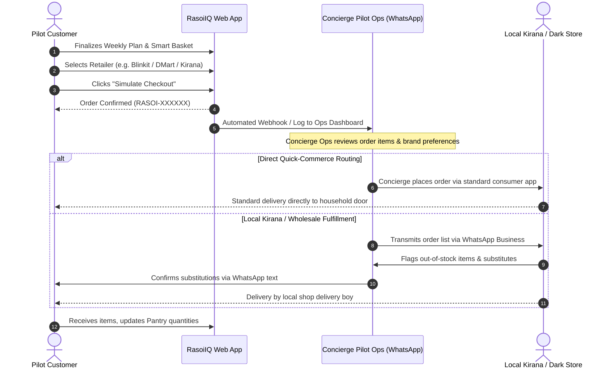

# RasoiIQ Phase 4: Pilot Operational Workflow & Concierge Fulfillment

## 1. Controlled Validation Pilot Objectives

The RasoiIQ Phase 4 Pilot is designed for **3–10 real households** in an urban Indian cluster (e.g. Bodakdev / Satellite / Navrangpura, Ahmedabad or Indiranagar / Koramangala, Bengaluru) for an initial duration of 2 to 4 weeks.

The primary goals are:
1. Validate whether AI meal planning and automated grocery aggregation reduce household planning anxiety.
2. Confirm domestic cook (*Maharaj*) adoption via daily preparation summaries.
3. Validate grocery basket pricing, pack sizing accuracy, and pantry deduction mechanics.
4. Maintain **100% Zero-Cost operations** without building expensive, premature automated delivery APIs.

---

## 2. Concierge Grocery Fulfillment Model



### Why Concierge Fulfillment Wins for Early Pilots:
- **Zero Integration Cost**: No official API access required from Blinkit, Zepto, or Swiggy Instamart (who strictly restrict public partner APIs).
- **High Empathy & Touchpoint**: Immediate visibility into edge cases (e.g., brand preferences like "fortune over loose", vegetable freshness, replacement tolerances).
- **Authentic Data Collection**: Uncovers real-world pricing fluctuations and pack size availability in specific micro-markets.

---

## 3. Item Availability & Substitution Tracking

In real-world grocery procurement, items frequently go out of stock or require substitutions. Phase 4 introduces `ItemFulfillmentStatus`:
```typescript
export type ItemFulfillmentStatus = 'AVAILABLE' | 'UNAVAILABLE' | 'SUBSTITUTED';
```

When an item is modified by the concierge manager or retailer partner:
- `AVAILABLE`: Standard fulfillment as requested.
- `UNAVAILABLE`: Marked in order details; excluded from billing total.
- `SUBSTITUTED`: Accompanied by `substitutionNotes` (e.g. *"Substituted Balaji Ratlami Sev 200g with Bikaji Bhujia 200g (+₹5)"*).

---

## 4. Retailer B2B Catalog Management

Local kirana stores and pilot micro-retailers can manage prices and inventory through the authenticated partner portal:
- Endpoint: `PUT /api/marketplace/retailer/:id/product/:variantId`
- Role required: `RETAILER` or `ADMIN`
- Body:
  ```json
  {
    "inStock": true,
    "customPriceInr": 219,
    "itemStatus": "AVAILABLE"
  }
  ```
- Isolation Guarantee: A partner logged into Blinkit cannot modify Zepto or local kirana inventory (enforced with `403 Forbidden`).

---

## 5. Domestic Cook (*Maharaj*) Workflow

The domestic cook is the central executor of the household meal plan. The Maharaj Workflow bridges the digital app and kitchen operations:

1. **Evening Review (8:00 PM)**:
   The household coordinator (e.g., Pooja Sharma) opens the **Weekly Meal Planner** and taps **Cook Digest**.
2. **Day Selection**:
   Coordinator toggles tomorrow (e.g. Tuesday) to see:
   - **Overnight Soaking Alert**: Legumes that must be soaked before bed (e.g. *Kabuli Chana* for Chole: 250g, 8 hours).
   - **Advance Prep Tasks**: Morning tasks (e.g. kneading Bajra Rotlo dough, making Methi Muthiya).
   - **Family Dietary Notes**: Critical health reminders (e.g. *"No onion or garlic in grandfather's portion"*).
   - **Total Servings**: Exact plate count for lunch and dinner.
3. **Dispatch to Cook**:
   - **WhatsApp One-Click Copy**: Copies clean, emoji-formatted plain text directly to the clipboard, formatted in simple Hinglish/Gujarati for instant forwarding to the cook's WhatsApp.
   - **Print / PDF**: Generates a clean, distraction-free monochrome print sheet designed to be magnetically attached to the kitchen refrigerator.
