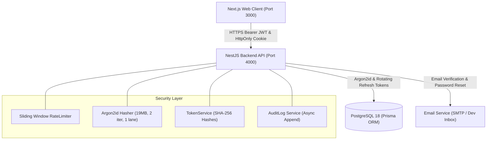

# RasoiIQ Phase 5.0 — Public Authentication Architecture

## 1. Architectural Overview

RasoiIQ Phase 5.0 transitions the platform from a founder-supervised demo environment into an enterprise-grade, public multi-user architecture. The security boundary guarantees complete multi-household isolation, cryptographic identity verification, sliding-window rate limiting, and zero-cost local execution.

## 2. Security Primitives & Cryptographic Standards

| Security Dimension | Standard / Specification | Justification |
| :--- | :--- | :--- |
| **Password Hashing** | Argon2id (`v=19`, `m=19456`, `t=2`, `p=1`) | Winner of Password Hashing Competition; resistant against GPU side-channel and ASIC cracking attacks. |
| **Access Tokens** | JWT signed with HMAC-SHA256, 15-minute TTL | Ephemeral credentials limiting the window of vulnerability upon exfiltration; contains unique `jti` for immediate server-side blacklist revocation. |
| **Refresh Tokens** | Cryptographic 64-hex random string, 7-day TTL | Stored hashed via SHA-256 (`tokenHash`) in `RefreshSession` table. Raw token delivered via `HttpOnly`, `SameSite=Lax` cookie and response payload. |
| **Token Rotation** | 1-for-1 replacement on `/auth/refresh` | Every refresh request invalidates the prior token and generates a new token belonging to the same `tokenFamilyId`. |
| **Replay Detection** | Token Family Invalidation | If an already-rotated token is presented, the system detects replay/theft, revokes the entire `tokenFamilyId`, and alerts the user. |
| **Email Tokens** | 64-char crypto random string, SHA-256 hashed in DB | 24-hour TTL for verification; 1-hour TTL for password recovery; single-use `consumedAt` timestamp. |

## 3. End-to-End Authentication Lifecycle

### 3.1 Registration & Anti-Enumeration
1. Client submits `fullName`, `email`, `password`, `confirmPassword`, `phone` (optional), and `acceptTerms=true` to `POST /api/auth/register`.
2. Password validated against policy: minimum 12 characters, non-empty, checks against Top 100 common password blocklist.
3. If email exists, the API returns a generic HTTP 201/200 success response ("Registration received. Please check your email to verify your account.") without revealing user existence (preventing account enumeration attacks).
4. New accounts are created in `PENDING_VERIFICATION` state with `emailVerifiedAt = null`.
5. Cryptographic token generated, SHA-256 hashed, stored in `EmailVerificationToken`, and dispatched via email.

### 3.2 Verification & Account Activation
1. User clicks link: `http://localhost:3000/verify-email?token=<RAW_TOKEN>`.
2. Client posts token to `POST /api/auth/verify-email`.
3. Server computes SHA-256 hash of token, finds unconsumed record where `expiresAt > NOW()`.
4. Transactionally marks token `consumedAt = NOW()`, sets `User.status = 'ACTIVE'`, and updates `User.emailVerifiedAt = NOW()`.
5. Returns access token, refresh token, and user profile.

### 3.3 Rotating Refresh Sessions
- Session records stored in PostgreSQL `RefreshSession`:
  - `id`: CUID identifier
  - `userId`: Relation to `User`
  - `tokenHash`: SHA-256 hash of refresh token
  - `tokenFamilyId`: UUID grouping rotation lineage
  - `deviceName` & `userAgent`: Browser / device fingerprint
  - `ipAddress`: Client IP address
  - `expiresAt`: 7-day timestamp
  - `revokedAt`: Revocation timestamp (null when active)

## 4. Zero-Cost Principle
All authentication logic relies strictly on open-source Node.js libraries (`argon2`, `jsonwebtoken`, `crypto`, `@prisma/client`) and self-hosted PostgreSQL 18. No third-party SaaS auth (Auth0, Clerk, Firebase) or paid SMS OTP services are required.
