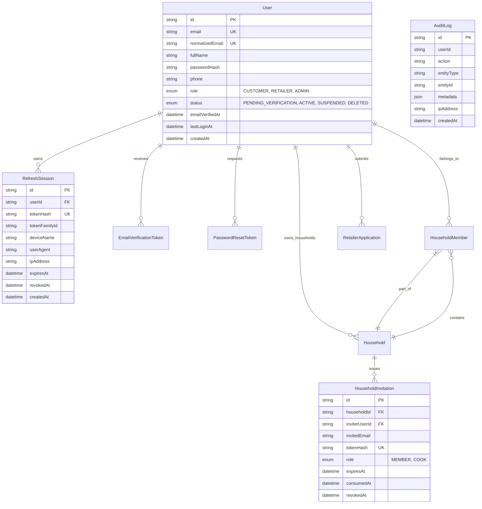

# RasoiIQ Phase 5.0 — Database Identity Schema

## 1. Schema Extensions in PostgreSQL 18 (Prisma ORM)

Phase 5.0 extends the relational database schema to support multi-tenant identity, persistent session tracking, invitation management, and audit logging.

## 2. Table Specifications

### 2.1 `User`
- `id`: CUID identifier
- `email`: Normalized unique lowercase email address
- `normalizedEmail`: Canonical address stripped of '+' extensions
- `passwordHash`: Argon2id modular crypt format string (`$argon2id$v=19$m=19456,t=2,p=1$...`)
- `status`: `UserStatus` enum (`PENDING_VERIFICATION`, `ACTIVE`, `SUSPENDED`, `DELETED`)
- `role`: `Role` enum (`CUSTOMER`, `RETAILER`, `ADMIN`)
- `emailVerifiedAt`: Timestamp of successful token verification
- `lastLoginAt`: Timestamp of latest session establishment

### 2.2 `RefreshSession`
- `tokenHash`: SHA-256 hash of plaintext 64-hex refresh token (unique index)
- `tokenFamilyId`: UUID establishing refresh lineage for replay detection
- `revokedAt`: Null while session is valid; set to timestamp upon explicit logout, timeout, or replay violation

### 2.3 `HouseholdMember`
- `householdId`: Foreign key to `Household`
- `userId`: Foreign key to `User` (optional for unlinked legacy demo profiles)
- `role`: `HouseholdRole` enum (`OWNER`, `MEMBER`, `COOK`)
- `status`: Active or suspended membership
- `joinedAt`: Timestamp of onboarding

### 2.4 `HouseholdInvitation`
- `householdId`: Destination household
- `inviterUserId`: Household owner issuing the invitation
- `invitedEmail`: Recipient email address
- `tokenHash`: SHA-256 hash of single-use invitation token
- `role`: Granted permission (`MEMBER` for family, `COOK` for Maharaj)
- `expiresAt`: Fixed 7-day expiration timestamp

### 2.5 `RetailerApplication`
- `userId`: Submitting customer account
- `businessName`: Commercial name of merchant
- `status`: `RetailerApplicationStatus` (`PENDING`, `APPROVED`, `REJECTED`, `SUSPENDED`)
- `reviewedByUserId`: Platform administrator conducting review
- `reviewedAt`: Timestamp of administrative determination

### 2.6 `AuditLog`
- Immutable append-only record tracking security events: `USER_REGISTERED`, `EMAIL_VERIFIED`, `LOGIN_SUCCESS`, `LOGIN_FAILURE`, `REFRESH_REPLAY_DETECTED`, `HOUSEHOLD_CREATED`, `HOUSEHOLD_INVITATION_ACCEPTED`, `RETAILER_APPROVED`.
