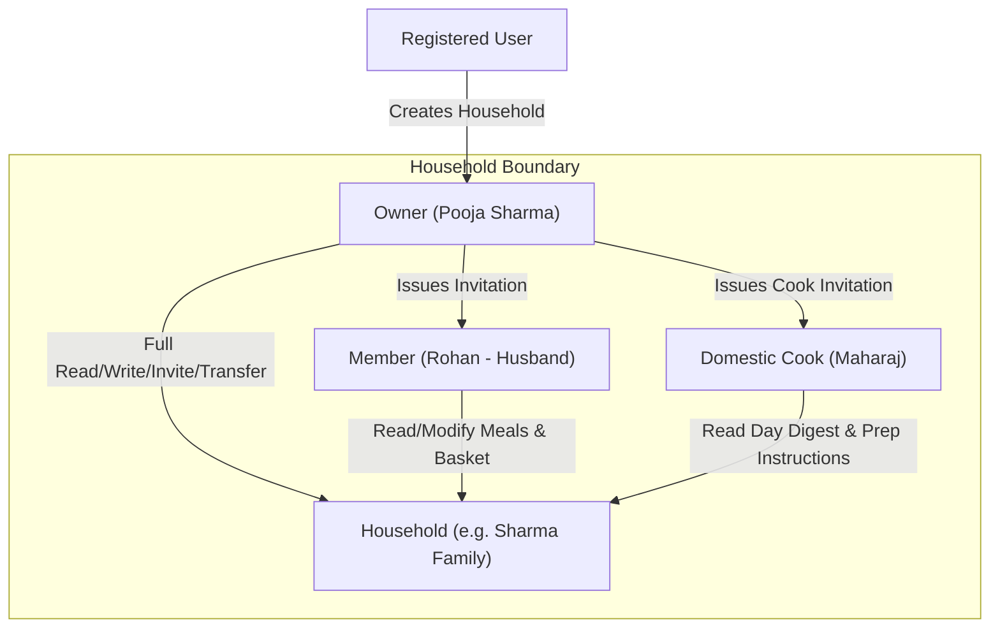

# RasoiIQ Phase 5.0 — Household Membership & Role-Based Permissions

## 1. Household Hierarchy & Role Matrix

Every household in RasoiIQ represents a distinct culinary unit with its own dietary preferences, regional cuisine guidelines, weekly budget, pantry inventory, meal plans, and grocery orders.



### 1.1 Permission Matrix

| Capability / Action | OWNER | MEMBER | COOK | External User |
| :--- | :---: | :---: | :---: | :---: |
| **View Household Profile** | ✅ | ✅ | ❌ | ❌ (403) |
| **Update Dietary / Regional Preferences** | ✅ | ❌ (403) | ❌ (403) | ❌ (403) |
| **Manage Weekly Budget & City** | ✅ | ❌ (403) | ❌ (403) | ❌ (403) |
| **Add / Remove Family Members** | ✅ | ❌ (403) | ❌ (403) | ❌ (403) |
| **Issue Member Invitations** | ✅ | ❌ (403) | ❌ (403) | ❌ (403) |
| **Transfer Ownership** | ✅ | ❌ (403) | ❌ (403) | ❌ (403) |
| **View 7-Day Meal Plan** | ✅ | ✅ | ❌ | ❌ (403) |
| **Swap Recipes & Generate AI Plans** | ✅ | ✅ | ❌ (403) | ❌ (403) |
| **View Maharaj Cook Daily Digest** | ✅ | ✅ | ✅ | ❌ (403) |
| **Manage Pantry Items** | ✅ | ✅ | ❌ (403) | ❌ (403) |
| **View Smart Basket & Place Orders** | ✅ | ✅ | ❌ (403) | ❌ (403) |

## 2. Insecure Direct Object Reference (IDOR) Defenses

Every household-scoped controller endpoint (`/households/:id`, `/meal-plans`, `/pantry`, `/grocery/basket`, `/marketplace/orders/:id`) executes mandatory authorization resolution:

```typescript
// services/api/src/household/household.service.ts
async assertHouseholdPermission(userId: string, householdId: string, requiredRole: 'OWNER' | 'MEMBER' | 'COOK'): Promise<void> {
  const role = await this.getUserHouseholdRole(userId, householdId);
  if (!role) {
    throw new ForbiddenException(`You are not a member of household "${householdId}".`);
  }
  if (requiredRole === 'OWNER' && role !== 'OWNER') {
    throw new ForbiddenException('Only the household OWNER has permission to perform this action.');
  }
  if (requiredRole === 'MEMBER' && role === 'COOK') {
    throw new ForbiddenException('Domestic cooks do not have permission to manage household configuration or grocery orders.');
  }
}
```

## 3. Invitation Token Lifecycle & Atomic Acceptance
1. **Creation**: The `OWNER` calls `POST /api/households/:id/invitations` specifying `invitedEmail` and `role` (`MEMBER` or `COOK`).
2. **Cryptographic Token**: Generates 32 bytes of secure random bytes, stores the SHA-256 hash with a 7-day expiration.
3. **Inspection**: The recipient can publicly inspect the token via `GET /api/households/invitations/validate?token=...` to verify the household name before accepting.
4. **Atomic Acceptance**: In a PostgreSQL transaction, `POST /api/households/invitations/accept`:
   - Checks that the token has not been consumed or revoked.
   - Verifies that `user.email` matches `invitedEmail` (or user confirms linking).
   - Validates that the user is not already a member of the target household.
   - Inserts the new record into `HouseholdMember`.
   - Sets `consumedAt = NOW()` on the invitation.
