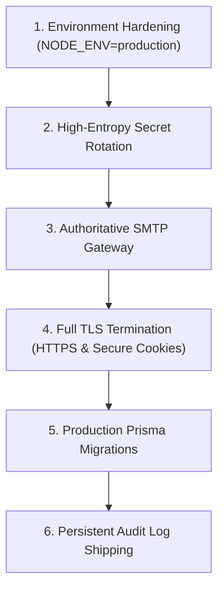

# RasoiIQ Phase 5.0 — Production Configuration Checklist

## 1. Production Readiness Audit

Prior to deploying RasoiIQ into a public production environment (cloud VM, Kubernetes cluster, or hosted container runtime), all items on this checklist must be satisfied.

## 2. Mandatory Verification Checklist

### 2.1 Environment Isolation & Demo Deactivation
- [ ] `NODE_ENV=production` is strictly set.
- [ ] `ALLOW_DEMO_AUTH=false` is enforced (blocks `/auth/demo-session` and sample bypasses).
- [ ] Development email viewer (`/api/dev/emails`) is automatically disabled in production.
- [ ] `REQUIRE_DATABASE=true` ensures the application halts immediately if PostgreSQL is unreachable.

### 2.2 Cryptographic Secrets Management
- [ ] `JWT_SECRET` generated using 256+ bits of entropy (`openssl rand -hex 64`).
- [ ] Database credentials (`DATABASE_URL`) stored in a secure secret manager (e.g. AWS Secrets Manager, HashiCorp Vault, Doppler).
- [ ] Zero secrets committed to git repository or exposed via `NEXT_PUBLIC_` frontend environment variables.

### 2.3 Email Delivery Infrastructure
- [ ] `SMTP_HOST`, `SMTP_PORT`, `SMTP_USER`, and `SMTP_PASS` configured with a reputable transactional email provider (SendGrid, Postmark, AWS SES, or Brevo).
- [ ] SPF, DKIM, and DMARC DNS records configured for `@rasoiiq.in` to prevent verification emails from landing in spam.
- [ ] Rate limits configured on `/auth/resend-verification` and `/auth/forgot-password` to protect email reputation.

### 2.4 Cookie & Transport Security
- [ ] HTTPS enforced across all routes with HSTS enabled (`Strict-Transport-Security: max-age=63072000; includeSubDomains; preload`).
- [ ] Refresh token cookie set with `Secure; HttpOnly; SameSite=Lax`.
- [ ] CORS origin restricted strictly to the verified frontend domain (`https://app.rasoiiq.in`).

### 2.5 Database & Data Protection
- [ ] PostgreSQL 18 automated daily backups configured with point-in-time recovery (PITR).
- [ ] Pre-deployment database migrations applied via `npx prisma migrate deploy` (never `db push` in production).
- [ ] Connection pooling configured via PgBouncer or Prisma Accelerate for high-concurrency traffic.
- [ ] Database replication configured for high availability (primary-replica).

### 2.6 Incident Response & Audit Logging
- [ ] `AuditLog` table configured with log forwarding / SIEM integration.
- [ ] Automated alerting on `REFRESH_REPLAY_DETECTED` events (indicates stolen credentials).
- [ ] Platform administrator bootstrapped via offline CLI (`scripts/bootstrap-admin.mjs`).
