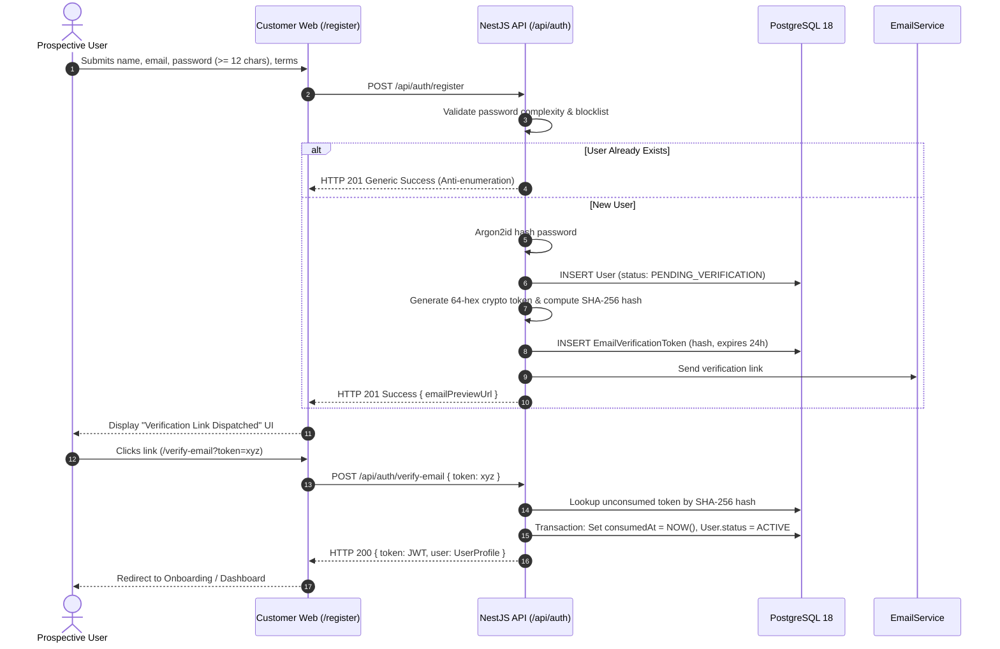

# RasoiIQ Phase 5.0 — Registration & Email Verification Workflow

## 1. Overview
The registration workflow allows any public user to create a personal account while enforcing strict password entropy standards, anti-enumeration security, and verifiable email ownership prior to granting household access.

## 2. Password Policy Specification

### 2.1 Enforcement Rules
1. **Length Requirement**: Minimum 12 characters (`password.length >= 12`). No arbitrary maximum (supports 100+ character passphrases).
2. **Unicode & Internationalization**: Full UTF-8 support including spaces, punctuation, Indic scripts, and emoji.
3. **Common Password Blocklist**: Rejects top common insecure passwords (`password1234`, `123456789012`, `qwertyuiop12`, `welcome12345`, `administrator`).
4. **Argon2id Parameters**:
   - Memory cost: 19,456 KiB (19 MiB)
   - Iterations (Time cost): 2 passes
   - Parallelism: 1 lane
   - Hash length: 32 bytes

## 3. Email Verification Delivery Abstraction

The application implements an environment-aware delivery strategy (`EmailService`):

| Environment | Transport Mode | Behavior |
| :--- | :--- | :--- |
| **Development (`NODE_ENV != 'production'`)** | In-Memory Dev Mailbox | Emails captured in memory. Exposed at `GET /api/dev/emails` with a clickable HTML viewer for local verification. |
| **Production (`NODE_ENV == 'production'`)** | Standard SMTP Transport | Dispatched via configured SMTP server (`SMTP_HOST`, `SMTP_PORT`, `SMTP_USER`, `SMTP_PASS`). Never logs raw tokens to stdout. |

## 4. Anti-Enumeration Guarantees
- `POST /api/auth/register`: Returns HTTP 201 with identical payload structure whether the email was newly registered or already exists in the database.
- `POST /api/auth/resend-verification`: Returns HTTP 200 with message `"If an unverified account exists for this email address, a new verification link has been dispatched"` regardless of account presence.
- Timing attack mitigation: Consistent computational latency observed during duplicate checks.
