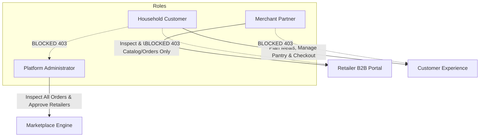

# RasoiIQ Phase 5.0 — Retailer & Admin Access Control

## 1. System Role Hierarchy

RasoiIQ maintains three strict top-level system roles enforced via NestJS `RolesGuard`:



## 2. Retailer Onboarding & Vetting Workflow

In compliance with enterprise security requirements, **merchants cannot self-register directly into the RETAILER role**.

### 2.1 Public Merchant Application
1. A registered customer visits `/retailer/apply` and submits commercial details:
   - Business Legal Name
   - Primary Contact Person & Mobile Number
   - Target Operating Cities
   - Estimated SKU catalog size
2. Submitted to `POST /api/marketplace/retailer/apply`.
3. An entry is created in `RetailerApplication` with status `PENDING`.
4. The user retains their normal `CUSTOMER` role with zero elevated permissions.

### 2.2 Administrative Review & Privilege Escalation
1. An administrator signs in and accesses `GET /api/marketplace/admin/retailer-applications`.
2. Upon verification, the admin submits a determination to `POST /api/marketplace/admin/retailer-applications/:id/review`:
   - Decision: `APPROVED` or `REJECTED`
   - Reviewer notes
3. When approved, a PostgreSQL transaction:
   - Updates `RetailerApplication.status = 'APPROVED'`
   - Updates `User.role = 'RETAILER'`
   - Associates or creates the merchant's retailer profile
   - Appends an audit entry `RETAILER_APPROVED`

## 3. Multi-Tenant Merchant Isolation (B2B)

Merchants are strictly isolated from competing retailers and customer private data:

| Target Endpoint | Blinkit Retailer (`ret-blinkit`) | Zepto Retailer (`ret-zepto`) | Platform Admin | Customer |
| :--- | :---: | :---: | :---: | :---: |
| `GET /marketplace/retailer/ret-blinkit/inventory` | ✅ 200 OK | ❌ 403 Forbidden | ✅ 200 OK | ❌ 403 |
| `PUT /marketplace/retailer/ret-blinkit/product/:id` | ✅ 200 OK | ❌ 403 Forbidden | ✅ 200 OK | ❌ 403 |
| `GET /marketplace/retailer/ret-zepto/inventory` | ❌ 403 Forbidden | ✅ 200 OK | ✅ 200 OK | ❌ 403 |
| `GET /households/:id` | ❌ 403 Forbidden | ❌ 403 Forbidden | ✅ 200 OK | Household Member Only |
| `GET /marketplace/admin/metrics` | ❌ 403 Forbidden | ❌ 403 Forbidden | ✅ 200 OK | ❌ 403 |

## 4. Secure Administrator Bootstrapping (CLI-Only)

To prevent web-based privilege escalation or malicious admin account creation:
- **No public administrative registration HTTP endpoint exists.**
- Administrators are created exclusively via an offline administrative CLI command:
  ```bash
  node scripts/bootstrap-admin.mjs --email="admin@rasoiiq.in" --fullName="Platform Administrator" --password="SecureMasterPassword2026!"
  ```
- The bootstrap script validates that the invoker has direct database access, hashes credentials using Argon2id, assigns `ADMIN` role, marks email verified immediately, and logs the initialization in `AuditLog`.
