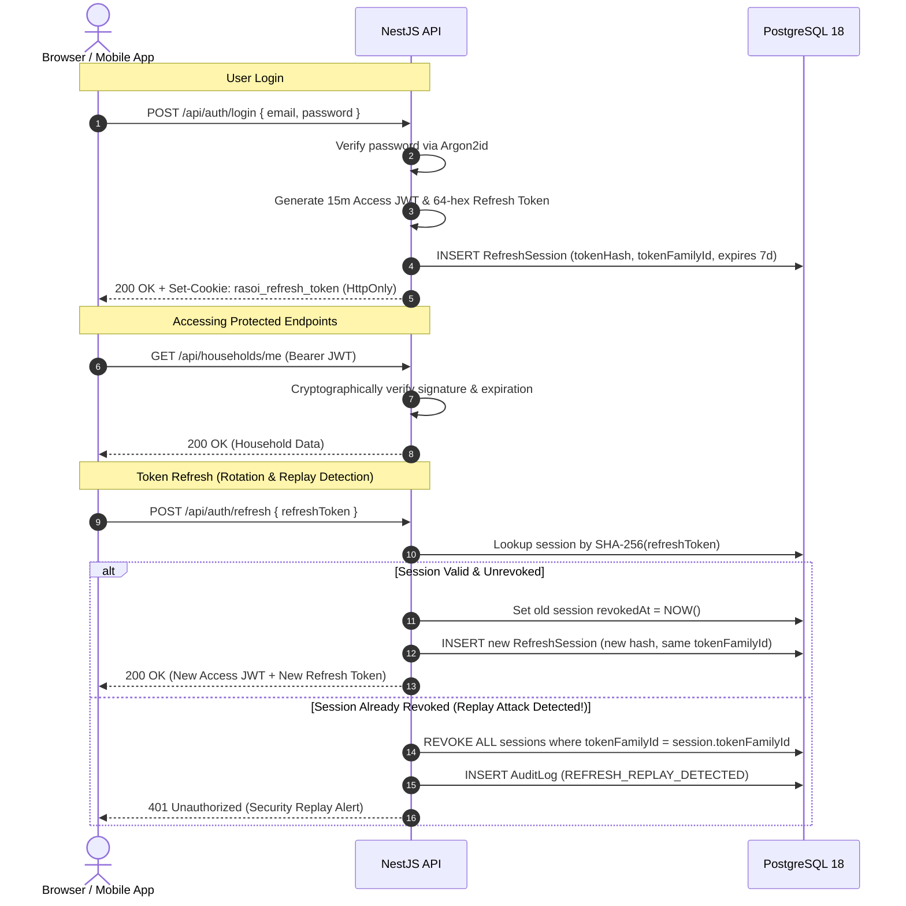

# RasoiIQ Phase 5.0 — Session Management & Token Security

## 1. Dual-Token Architecture

RasoiIQ separates short-lived stateless authorization from long-lived stateful refresh sessions.



## 2. Token Specifications & Claims

### 2.1 Access Token (JWT)
- **Signature**: HMAC-SHA256 (`HS256`)
- **TTL**: 15 minutes (`900` seconds)
- **Payload Claims**:
  - `sub`: User ID
  - `email`: User primary email
  - `role`: System role (`CUSTOMER`, `RETAILER`, `ADMIN`)
  - `householdId`: Default primary household association
  - `retailerId`: Merchant partner identifier (if retailer)
  - `jti`: Cryptographically random UUID for server-side revocation tracking
  - `iat` / `exp`: Standard issued-at and expiration timestamps

### 2.2 Refresh Token
- **Entropy**: 64 hexadecimal characters generated from `crypto.randomBytes(32)` (256 bits of cryptographic entropy).
- **Storage**: Raw plaintext tokens are NEVER stored in the database. Only the SHA-256 digest (`crypto.createHash('sha256').update(token).digest('hex')`) is persisted in `RefreshSession.tokenHash`.
- **TTL**: 7 days (`604,800` seconds).
- **Transport**: Stored in `HttpOnly`, `SameSite=Lax`, `Secure` (in production) cookies, and returned in the JSON response payload.

## 3. Replay Detection & Token Families
When an attacker intercepts a refresh token and attempts to use it after the legitimate client has already rotated it:
1. The server detects that `revokedAt` is not null.
2. The server identifies the `tokenFamilyId`.
3. An immediate revocation query terminates **all sessions** sharing that `tokenFamilyId`:
   ```sql
   UPDATE "RefreshSession" SET "revokedAt" = NOW() WHERE "tokenFamilyId" = $1;
   ```
4. An audit event `REFRESH_REPLAY_DETECTED` is recorded.
5. Both the legitimate client and the attacker receive HTTP 401 Unauthorized, forcing re-authentication.

## 4. Revocation Capabilities
- **Single-Device Logout**: `POST /api/auth/logout` revokes the specific session and blacklists the current JWT access token `jti`.
- **Global Logout**: `POST /api/auth/logout-all` invalidates every active refresh session for the authenticated user across all devices.
- **Selective Session Management**: `DELETE /api/auth/sessions/:sessionId` allows users to remotely terminate specific stale or unfamiliar devices from their account settings.
