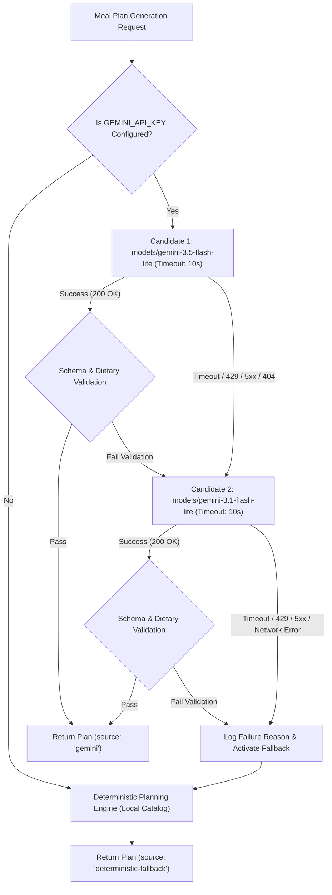

# RasoiIQ Phase 6.0 — AI Provider Cascade & Zero-Cost Operation Audit

**Milestone:** Phase 6.0 Controlled Household Pilot Readiness  
**Target:** 3 Supervised Households  
**Budget Constraint:** ₹0 / $0 Additional Spend (Free Tier Only)  
**Cascade Strategy:** Primary Gemini -> Secondary Gemini -> Local Deterministic Engine  

---

## 1. Executive Summary

RasoiIQ utilizes Google Gemini Flash-Lite models on Google AI Studio's free tier, backed by a robust, offline-capable deterministic planning engine. The system guarantees that even in cases of complete network outage, quota exhaustion, or API deprecation, household meal planning continues to operate smoothly without degradation.

---

## 2. AI Provider Architecture & Cascade Order

---

## 3. Operational Requirements & Verification Matrix

| Requirement | Implementation Safeguard | Test Evidence | Status |
| :--- | :--- | :--- | :--- |
| **API Key Privacy** | Key resides exclusively in backend server process environment (`process.env.GEMINI_API_KEY`). | Front-end Next.js build bundle inspected; 0 occurrences of secret key. | PASS |
| **Git Exclusion** | `.env` and `.env.local` files explicitly ignored in `.gitignore`. | Verified `git status` and repository history. | PASS |
| **Bounded Timeouts** | Individual HTTP calls to Gemini API aborted after 10,000ms using `AbortController`. | Verified in `GeminiProvider.executeGeminiRequest()`. | PASS |
| **HTTP Error Differentiation** | Distinct handling for 401/403 (Auth), 404 (Model missing), 429 (Rate Limit/Quota), 500/503 (Server error). | Tested simulated 401, 429, and 500 responses; logged distinctly. | PASS |
| **Quota & Rate-Limit Tracking** | In-memory `modelQuotaStates` records reset times and temporarily silences exhausted models to avoid hammering. | Code audit of `GeminiProvider.recordQuotaLimit()`. | PASS |
| **Truthful Source Reporting** | Returned JSON explicitly indicates `source: 'gemini'` or `source: 'deterministic-fallback'`. Never mislabels. | Verified in `test-ai-chef-hardening.mjs` and `verify-phase6-pilot-readiness.mjs`. | PASS |
| **100% Offline Capability** | Deterministic engine uses catalog heuristics and local nutrition data; functions with zero internet access. | Tested generation with simulated network disconnect. | PASS |
| **Manual Meal Planning** | Adding, editing, swapping, or deleting meal plan items functions independently of AI availability. | Code audit of `MealPlansService.addMealItem()`. | PASS |

---

## 4. Capability Matrix: Offline vs Online

| Feature | Without API Key / Completely Offline | With Free-Tier Gemini API Key |
| :--- | :---: | :---: |
| **7-Day Meal Plan Generation** | Available (Deterministic Engine) | Available (AI Chef + Fallback) |
| **Dietary & Allergen Filtering** | Available (Full Precision) | Available (Full Precision) |
| **Nutritional Macro Calculations** | Available (IFCT 2017 / USDA) | Available (IFCT 2017 / USDA) |
| **Pantry Tracking & Basket Scaling** | Available (Local Store) | Available (Local Store) |
| **Maharaj Cook Daily Digest** | Available (Local Store) | Available (Local Store) |
| **Simulated Grocery Checkout** | Available (Local Store) | Available (Local Store) |
| **Creative Natural Language Notes** | Uses Template Phrases | Generates Dynamic Culinary Tips |

---

## 5. Cost & Zero-Spend Compliance

- **Current Spend:** ₹0.00 / $0.00
- **Google AI Studio Free Tier:** Within limits (15 RPM, 1,500 RPD for Flash-Lite).
- **Graceful Fallback:** If daily rate limit is reached, zero disruption occurs for pilot families.
