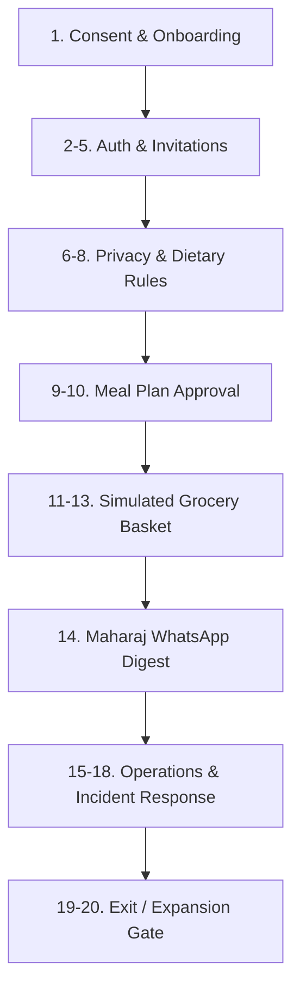

# RasoiIQ Phase 6.0 — Controlled Household Pilot Operational Runbook

**Document Reference:** `docs/phase-6/controlled-household-pilot-runbook.md`  
**Milestone:** Phase 6.0 — Controlled Household Pilot Readiness  
**Target Households:** 3 Initial Supervised Households (Max 10 Controlled Pilot)  
**Environment:** Local Workstation (`Windows 11` + `WSL2 Ubuntu` + `PostgreSQL 18.6`)  
**Budgetary Constraint:** ₹0 / $0 Additional Spend  

---

## 1. Executive Overview

This operational runbook governs the day-to-day execution, surveillance, safety procedures, and administrative protocols for the RasoiIQ Controlled Household Pilot. The pilot operates under strict supervised conditions with real culinary ingredients in domestic kitchens, but with **zero financial processing** and **zero public network exposure**.

Every operational action is tied to a specific responsible role, an explicit verification method, audit trail retention requirements, and an escalation procedure.

---

## 2. 20-Point Operational Checklist



---

### Item 1: Pilot Scope and Informed Consent
- **Responsible Role:** Pilot Operations Lead / Principal Architect
- **Required Action:** Execute bilingual (English & Hindi) Pilot Consent Form ([household-pilot-consent.md](file:///d:/Startup/docs/phase-6/household-pilot-consent.md)) physically or digitally with the primary household administrator prior to provisioning.
- **Verification Method:** Confirm countersigned PDF or physical sheet exists in operational pilot repository; check that all adult household participants acknowledge non-commercial, simulated grocery, and AI-assisted culinary limitations.
- **Evidence to Retain:** Countersigned consent scan in `docs/phase-6/consent/household-<id>-signed.pdf`, timestamped entry in operational tracker.
- **Failure / Escalation Procedure:** If any member declines or requests commercial financial guarantees, halt onboarding immediately. No account may be provisioned without verified countersignature.

---

### Item 2: Customer Account Creation
- **Responsible Role:** Household Administrator (Assisted by Support Lead)
- **Required Action:** Household head completes registration via customer portal (`http://127.0.0.1:3000/auth/register` or LAN proxy) providing full name, valid email, and strong password (min 10 characters, upper, lower, digit, symbol).
- **Verification Method:** Inspect PostgreSQL database for new record:
  ```bash
  wsl psql -U postgres -d rasoi_iq -c "SELECT id, email, status, \"isEmailVerified\", \"createdAt\" FROM \"User\" WHERE email = 'household.head@example.com';"
  ```
- **Evidence to Retain:** Database user UUID and system audit log ID (`USER_REGISTERED`).
- **Failure / Escalation Procedure:** If registration fails due to duplicate email or validation regex, inspect backend console logs (`task-8459`). Do not bypass password entropy constraints.

---

### Item 3: Email Verification
- **Responsible Role:** Support Lead / Platform Admin
- **Required Action:** In local offline mode (zero-cost SMTP disabled), retrieve generated one-time verification token from database and present to user or trigger verification endpoint.
- **Verification Method:**
  ```bash
  wsl psql -U postgres -d rasoi_iq -c "SELECT id, email, \"verificationToken\" FROM \"User\" WHERE email = 'household.head@example.com';"
  curl -s -X POST http://127.0.0.1:4000/api/auth/verify-email -H "Content-Type: application/json" -d '{"token":"<verificationToken>"}'
  ```
- **Evidence to Retain:** Audit log `EMAIL_VERIFIED`, database column `isEmailVerified = true`.
- **Failure / Escalation Procedure:** If token expired (>24 hrs), invoke `POST /api/auth/resend-verification`. If still failing, confirm user status is not `SUSPENDED`.

---

### Item 4: Household Invitations
- **Responsible Role:** Household Administrator
- **Required Action:** Primary household administrator invites secondary family members (spouse, cook, elders) via `/household/settings` with explicit roles (`MEMBER` or `CHEF`).
- **Verification Method:** Verify membership in database:
  ```bash
  wsl psql -U postgres -d rasoi_iq -c "SELECT hm.id, hm.\"householdId\", hm.role, u.email FROM \"HouseholdMember\" hm JOIN \"User\" u ON hm.\"userId\" = u.id WHERE hm.\"householdId\" = '<householdId>';"
  ```
- **Evidence to Retain:** Audit log entries for `HOUSEHOLD_MEMBER_INVITED` and `HOUSEHOLD_MEMBER_ACCEPTED`.
- **Failure / Escalation Procedure:** If invitation link fails, verify household owner membership status. Ensure maximum member limit per household (6 members) is not exceeded.

---

### Item 5: Password Recovery
- **Responsible Role:** Support Lead
- **Required Action:** Test secure self-service password reset flow on staging account. Ensure old tokens are invalidated upon use and refresh tokens revoked.
- **Verification Method:**
  ```bash
  curl -s -X POST http://127.0.0.1:4000/api/auth/forgot-password -H "Content-Type: application/json" -d '{"email":"household.head@example.com"}'
  # Verify RefreshSession revocation upon password change
  wsl psql -U postgres -d rasoi_iq -c "SELECT id, \"isRevoked\" FROM \"RefreshSession\" WHERE \"userId\" = '<userId>';"
  ```
- **Evidence to Retain:** `PASSWORD_RESET_COMPLETED` audit log entry, confirmation that all previous `RefreshSession` rows have `isRevoked = true`.
- **Failure / Escalation Procedure:** If reset token fails to revoke sessions, execute emergency session flush via SQL: `UPDATE "RefreshSession" SET "isRevoked" = true WHERE "userId" = '<userId>';`.

---

### Item 6: Household Privacy Verification
- **Responsible Role:** Platform Security Engineer
- **Required Action:** Execute automated cross-household isolation test suite to ensure Household B cannot inspect, mutate, or delete Household A's meal plans, inventory, or member details.
- **Verification Method:**
  ```bash
  node scripts/verify-phase6-pilot-readiness.mjs
  # Confirm Section 4 (Household Isolation) passes: HTTP 403 / 404 on cross-household ID queries
  ```
- **Evidence to Retain:** Test execution stdout showing Section 4 PASS (3/3 assertions), zero cross-tenant leakage.
- **Failure / Escalation Procedure:** If cross-tenant access returns 200 OK, immediately trigger Severity 1 incident, suspend suspect endpoint, and patch controller guard with `HouseholdMemberGuard`.

---

### Item 7: Dietary Preference Setup
- **Responsible Role:** Household Administrator (Supervised by Nutritionist)
- **Required Action:** Configure household dietary baseline in `/household/dietary` (e.g., VEGETARIAN, JAIN, EGGETARIAN, or VEGAN) and assign day-specific rules (e.g., "Strictly Vegetarian & No Onion/Garlic on Tuesdays and Saturdays").
- **Verification Method:**
  ```bash
  wsl psql -U postgres -d rasoi_iq -c "SELECT id, name, \"dietaryType\", \"isStrictJain\", \"avoidOnionGarlic\" FROM \"Household\" WHERE id = '<householdId>';"
  ```
- **Evidence to Retain:** Screenshot of configured household settings and PostgreSQL record export.
- **Failure / Escalation Procedure:** If day-specific rules do not persist, verify JSON payload structure in `PATCH /api/households/:id/preferences`.

---

### Item 8: Allergy and Disliked-Ingredient Review
- **Responsible Role:** Household Administrator & Safety Lead
- **Required Action:** Explicitly enter severe medical allergies (e.g., Peanuts, Tree Nuts, Lactose, Gluten, Mustard) and culinary dislikes (e.g., Karela, Tinda, Coriander) for each household member.
- **Verification Method:** Query allergy and dislike entries in database:
  ```bash
  wsl psql -U postgres -d rasoi_iq -c "SELECT id, \"memberId\", allergen, severity FROM \"MemberAllergy\" WHERE \"memberId\" IN (SELECT id FROM \"HouseholdMember\" WHERE \"householdId\" = '<householdId>');"
  ```
- **Evidence to Retain:** Double-verified sign-off sheet matching medical questionnaires to database allergy entries.
- **Failure / Escalation Procedure:** If a critical allergen is omitted in the database, lock meal plan generation for that household until corrected and re-verified.

---

### Item 9: Seven-Day Meal-Plan Generation
- **Responsible Role:** Household Lead
- **Required Action:** Trigger AI-assisted 7-day meal plan generation via `POST /api/meal-plans/generate`. Ensure deterministic safety filters sanitize the output.
- **Verification Method:** Inspect generated meal plan days, meal slots (Breakfast, Lunch, Dinner, Snack), and confirm zero allergen inclusions across all slots:
  ```bash
  wsl psql -U postgres -d rasoi_iq -c "SELECT mp.id, mp.week, mp.status, mps.day, mps.slot, r.title FROM \"MealPlan\" mp JOIN \"MealPlanSlot\" mps ON mp.id = mps.\"mealPlanId\" JOIN \"Recipe\" r ON mps.\"recipeId\" = r.id WHERE mp.\"householdId\" = '<householdId>';"
  ```
- **Evidence to Retain:** Complete JSON payload of generated meal plan; safety audit verification log.
- **Failure / Escalation Procedure:** If Gemini API fails or times out (>8s), verify fallback engine switches automatically to local deterministic rotating template without crashing.

---

### Item 10: Manual Household Meal-Plan Approval
- **Responsible Role:** Household Administrator
- **Required Action:** Household head reviews weekly plan in UI (`/meal-plans/current`), substitutes any unwanted recipes, and clicks "Approve Plan".
- **Verification Method:** Confirm meal plan state advances from `DRAFT` to `APPROVED`:
  ```bash
  wsl psql -U postgres -d rasoi_iq -c "SELECT id, \"householdId\", status, \"approvedAt\" FROM \"MealPlan\" WHERE id = '<mealPlanId>';"
  ```
- **Evidence to Retain:** Database audit log `MEAL_PLAN_APPROVED` with timestamp and user ID.
- **Failure / Escalation Procedure:** An unapproved plan cannot trigger grocery aggregation or Maharaj dispatch. If approval fails to persist, check user's role in household (`ADMIN` required).

---

### Item 11: Grocery Basket Customization
- **Responsible Role:** Household Member / Cook
- **Required Action:** Generate consolidated shopping list from approved meal plan (`POST /api/meal-plans/:id/generate-grocery-list`). Adjust quantities based on existing pantry stock.
- **Verification Method:** Verify generated basket items and pantry deduction:
  ```bash
  curl -s -H "Authorization: Bearer <jwt>" "http://127.0.0.1:4000/api/grocery-lists?householdId=<householdId>"
  ```
- **Evidence to Retain:** Finalized grocery basket JSON snapshot with custom item additions and exclusions.
- **Failure / Escalation Procedure:** If unit conversions fail (e.g., teaspoons to kilograms), flag item for manual quantity entry in UI before checkout simulation.

---

### Item 12: Sample Retailer Price Disclosure
- **Responsible Role:** Operations Lead
- **Required Action:** Ensure grocery basket display clearly identifies catalog prices as "Indicative Sample Pricing for Simulation Only" across all retailer options (Local Kirana, Supermarket, Organic Bazaar).
- **Verification Method:** Visual inspection of `/marketplace/cart` UI and API response verification:
  ```bash
  curl -s -H "Authorization: Bearer <jwt>" "http://127.0.0.1:4000/api/marketplace/catalog" | grep "samplePricing"
  ```
- **Evidence to Retain:** Frontend UI screenshot showing sample pricing disclaimer banner.
- **Failure / Escalation Procedure:** If pricing disclaimer is missing, halt cart checkout until disclaimer component is verified.

---

### Item 13: Simulation-Only Checkout
- **Responsible Role:** Household Administrator
- **Required Action:** Complete order placement via `POST /api/marketplace/checkout`. Verify transaction is flagged as a demo order with ₹0 financial charge.
- **Verification Method:**
  ```bash
  wsl psql -U postgres -d rasoi_iq -c "SELECT id, \"orderNumber\", status, \"isDemoOrder\", \"totalAmount\", \"paymentStatus\" FROM \"Order\" WHERE \"householdId\" = '<householdId>' ORDER BY \"createdAt\" DESC LIMIT 1;"
  ```
  *Assertion:* `isDemoOrder == true` and `paymentStatus == 'SIMULATED'`.
- **Evidence to Retain:** PostgreSQL order record showing `isDemoOrder = true` and `paymentStatus = 'SIMULATED'`.
- **Failure / Escalation Procedure:** If `isDemoOrder` is false or real payment gateway is called, kill checkout endpoint immediately; investigate gateway configuration.

---

### Item 14: Maharaj Preparation Workflow
- **Responsible Role:** Maharaj Coordinator / Support Lead
- **Required Action:** Generate daily prep digest for the household cook via `GET /api/meal-plans/maharaj-summary?householdId=<id>&day=<day>`. Send sanitized WhatsApp digest to cook.
- **Verification Method:**
  ```bash
  curl -s -H "Authorization: Bearer <jwt>" "http://127.0.0.1:4000/api/meal-plans/maharaj-summary?householdId=<id>&day=Monday"
  ```
  Confirm response contains: (1) Meal slots, (2) Soaking/advance alerts, (3) Strict dietary constraints, (4) WhatsApp emoji template, (5) Zero PII / phone numbers.
- **Evidence to Retain:** Generated WhatsApp message text copy and dispatch timestamp in operational log.
- **Failure / Escalation Procedure:** If allergy warnings are missing from Maharaj digest, do not dispatch to cook. Manually call household head to review prep list.

---

### Item 15: Support Access and Escalation
- **Responsible Role:** Support Agent (`SUPPORT` role)
- **Required Action:** When troubleshooting household issues, access support inspection endpoint with mandatory business reason (`POST /api/admin/support/inspect-household`).
- **Verification Method:**
  ```bash
  # Confirm phone is masked (XXXXXX1234) and audit log is created
  wsl psql -U postgres -d rasoi_iq -c "SELECT id, action, \"actorEmail\", \"targetType\", metadata FROM \"AuditLog\" WHERE action = 'SUPPORT_HOUSEHOLD_INSPECTED' ORDER BY \"createdAt\" DESC LIMIT 1;"
  ```
- **Evidence to Retain:** Audit log record with immutable ID, actor ID, and non-empty rationale.
- **Failure / Escalation Procedure:** If support access occurs without audit log generation, lock support account and notify Security Lead immediately.

---

### Item 16: Daily Database Backup
- **Responsible Role:** Database Reliability Engineer / Daily Operator
- **Required Action:** Execute automated daily backup script (`bash scripts/backup-rasoi.sh`) at 23:00 IST. Verify non-zero size, custom format (`.dump`), and permissions (`0600`).
- **Verification Method:**
  ```bash
  wsl bash scripts/backup-rasoi.sh
  wsl ls -la /var/backups/rasoi_iq/
  ```
- **Evidence to Retain:** Backup log entry, SHA-256 checksum of generated dump file.
- **Failure / Escalation Procedure:** If backup fails (exit code != 0 or size = 0), investigate disk space immediately. Re-run backup manually and alert Systems Lead.

---

### Item 17: AI Provider and Deterministic Fallback Verification
- **Responsible Role:** Platform Architect
- **Required Action:** Verify Gemini API connection status. Test automatic degradation to deterministic local engine by simulating API key misconfiguration.
- **Verification Method:**
  ```bash
  # Execute test suite section 7
  node scripts/verify-phase6-pilot-readiness.mjs
  # Confirm Section 7 PASS: Deterministic fallback successfully returns balanced 7-day meal plan
  ```
- **Evidence to Retain:** Test log verifying deterministic fallback response time (<50ms) and zero unhandled exceptions.
- **Failure / Escalation Procedure:** If fallback engine throws unhandled exception on Gemini failure, update `AiChefService` fallback catch block to return static curated templates.

---

### Item 18: Emergency Suspension and Incident Response
- **Responsible Role:** Operations Lead / Security Lead
- **Required Action:** Test instant account suspension capability (`POST /api/admin/users/:id/suspend`). Confirm immediate token rejection across protected routes.
- **Verification Method:**
  ```bash
  # Re-run Section 2 of readiness verification suite
  node scripts/verify-phase6-pilot-readiness.mjs
  # Confirm Section 2 PASS: 401 Unauthorized returned immediately after suspension
  ```
- **Evidence to Retain:** Audit log entry for `USER_SUSPENDED`, console log showing instant token rejection.
- **Failure / Escalation Procedure:** If revoked JWT continues to be accepted, execute DB kill command: `UPDATE "User" SET status = 'SUSPENDED' WHERE id = '<userId>';` and restart backend process.

---

### Item 19: Pilot Exit and Data Deletion
- **Responsible Role:** Privacy Officer / Platform Admin
- **Required Action:** If a household chooses to withdraw from the pilot, execute controlled data deletion or anonymization upon written request within 48 hours.
- **Verification Method:**
  ```bash
  # Anonymize customer data while retaining required compliance audit logs
  wsl psql -U postgres -d rasoi_iq -c "UPDATE \"User\" SET email = CONCAT('deleted_', id, '@anonymized.local'), \"fullName\" = 'Deleted User' WHERE id = '<userId>';"
  ```
- **Evidence to Retain:** Written exit request, database audit log `USER_DATA_ANONYMIZED`, signed deletion confirmation.
- **Failure / Escalation Procedure:** Never delete rows from `AuditLog`. If FK constraint blocks user anonymization, orphan related non-critical child records via transaction.

---

### Item 20: Expansion Approval
- **Responsible Role:** Steering Committee (Principal Architect, Safety Lead, Operations Lead)
- **Required Action:** Conduct comprehensive review of pilot metrics after 14 consecutive days of 3-household operation.
- **Verification Method:** Check all expansion gates:
  1. 100% allergy compliance (0 incidents).
  2. 100% daily backup success (14/14 successful restore tests).
  3. 0 unauthorized cross-tenant data leaks.
  4. Average household NPS >= 8/10.
- **Evidence to Retain:** Signed Phase 6 Expansion Certificate authorizing onboarding of Households 4 through 10.
- **Failure / Escalation Procedure:** If any critical incident occurred or backup restore failed, extend 3-household observation period by an additional 14 days.

---

## 3. Daily Operating Schedule

| Time (IST) | Phase | Responsible | Mandatory Actions |
| :--- | :--- | :--- | :--- |
| **07:00 - 07:30** | **Morning Verification** | Daily Operator | 1. Check API (`task-8459`) and Frontend (`task-6899`) health.<br>2. Confirm DB connectivity (`pg_isready`).<br>3. Verify today's planned meals for active households.<br>4. Generate and review Maharaj prep summaries. |
| **12:00 - 12:30** | **Midday Monitoring** | Support Lead | 1. Review application error logs for unhandled 500s.<br>2. Inspect audit logs for support access or failed logins.<br>3. Check Gemini API rate limits and fallback frequencies. |
| **19:00 - 19:30** | **Evening Reconciliation** | Operations Lead | 1. Reconcile simulated checkout orders (`isDemoOrder = true`).<br>2. Log household culinary feedback or recipe adjustments.<br>3. Verify tomorrow's advance prep / soaking alerts. |
| **23:00 - 23:30** | **Nightly Backup & Maintenance** | DRE / Operator | 1. Run `wsl bash scripts/backup-rasoi.sh`.<br>2. Verify backup non-empty and permissions `0600`.<br>3. Run `wsl bash scripts/verify-rasoi-backup.sh`.<br>4. Confirm retention policy (prune dumps > 7 days). |

---

## 4. Weekly Review Schedule (Every Sunday 16:00 IST)

1. **Dietary & Allergy Audit:**
   - Query all meal plans served during the week against member allergy profiles.
   - Confirm zero prohibited ingredients were suggested or consumed.
2. **Simulation Financial Audit:**
   - Confirm zero real INR transactions occurred.
   - Check all orders have `isDemoOrder = true` and `paymentStatus = 'SIMULATED'`.
3. **Disaster Recovery Drill:**
   - Execute full restore test using `scripts/verify-rasoi-backup.sh` into `rasoi_iq_recovery_test`.
   - Verify table integrity, trigger immutability, and active user records.
4. **Household Feedback Session:**
   - Conduct 15-minute structured check-in with each household lead.
   - Record recipe satisfaction, portion size accuracy, and Maharaj prep clarity.
