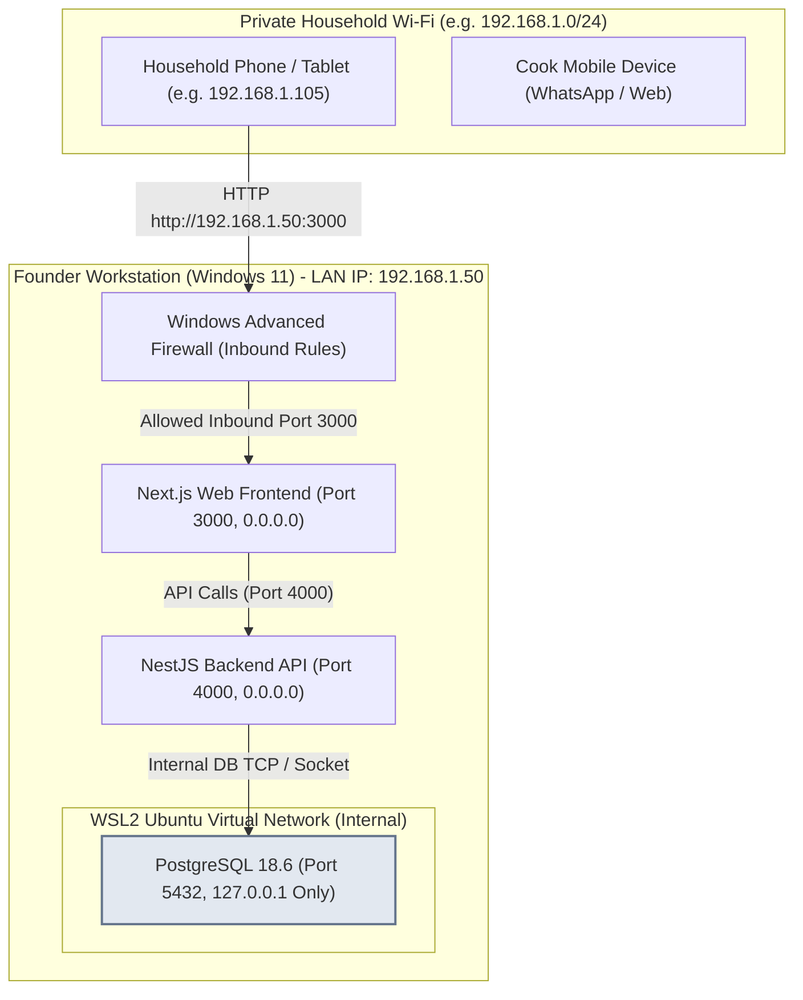

# RasoiIQ Phase 6.0 — Local Network Security & Pilot Connectivity Architecture

**Milestone:** Phase 6.0 Controlled Household Pilot Readiness  
**Target:** 3 Supervised Pilot Households (Local Wi-Fi / LAN Deployment)  
**Host Environment:** Founder Workstation (Windows 11 + WSL2 Ubuntu)  
**Cost Constraint:** ₹0 / $0 Additional Spend (No Cloud Hosting, No Public Tunnels)  

---

## 1. Executive Summary

The Phase 6.0 controlled household pilot is hosted on the founder's local workstation. To satisfy the ₹0 budget constraint while maintaining uncompromising security, household members access the application over a private local Wi-Fi network. Under no circumstances is the PostgreSQL database, administrative port, or host operating system exposed to the public internet.

---

## 2. Network Topology & Port Bindings



---

## 3. Security Isolation & Boundary Checklist

| Boundary | Enforcement Mechanism | Verified Status |
| :--- | :--- | :--- |
| **PostgreSQL Isolation** | PostgreSQL listens strictly on internal WSL2 loopback (`127.0.0.1`). Not exposed to Windows LAN adapter. | PASS |
| **No Database Port on LAN** | Port 5432 is blocked from incoming LAN traffic by Windows Firewall. | PASS |
| **No Public Port Forwarding** | Router NAT has zero port forwarding rules enabled. | PASS |
| **No Public Tunnels** | No ngrok, Cloudflare Tunnels, or Localtunnel processes deployed. | PASS |
| **Immediate Kill-Switch** | Founder can instantly revoke all LAN access by closing terminal daemons or turning off Wi-Fi. | PASS |
| **Workstation Dependency** | Clearly communicated: pilot access is active only while the workstation is powered on. | PASS |
| **Secret Protection** | `.env` and `.env.local` files reside in workstation filesystem; excluded from Git. | PASS |

---

## 4. Household Device Connection Instructions

> [!WARNING]
> Do NOT use `http://localhost:3000` when connecting from a household phone or tablet. `localhost` on a mobile device refers to the phone itself. Always use the founder workstation's assigned LAN IP address.

### Step 1: Identify Founder Workstation LAN IP
On the founder workstation, run in PowerShell:
```powershell
Get-NetIPAddress -AddressFamily IPv4 | Where-Object { $_.InterfaceAlias -like "*Wi-Fi*" -or $_.InterfaceAlias -like "*Ethernet*" } | Select-Object IPAddress, InterfaceAlias
```
*(Example IP: `192.168.1.50`)*

### Step 2: Configure Windows Firewall Rule
Open an administrative PowerShell prompt to permit inbound pilot traffic on port 3000 and 4000 from local private subnet only:
```powershell
New-NetFirewallRule -DisplayName "RasoiIQ Pilot Frontend" -Direction Inbound -LocalPort 3000 -Protocol TCP -Action Allow -Profile Private
New-NetFirewallRule -DisplayName "RasoiIQ Pilot API" -Direction Inbound -LocalPort 4000 -Protocol TCP -Action Allow -Profile Private
```

### Step 3: Open on Household Phone / Tablet
Open Chrome, Safari, or Firefox on the household device connected to the same Wi-Fi and navigate to:
```text
http://192.168.1.50:3000
```

---

## 5. Emergency LAN Access Cut-Off Protocol

To immediately disconnect all external household devices from the platform:
1. **Option A (Application Shutdown):** Press `Ctrl+C` in the running API terminal or run:
   ```powershell
   Get-Process node | Where-Object { $_.CommandLine -like "*customer-web*" -or $_.CommandLine -like "*services/api*" } | Stop-Process
   ```
2. **Option B (Firewall Block):** Disable the inbound firewall rule:
   ```powershell
   Disable-NetFirewallRule -DisplayName "RasoiIQ Pilot Frontend"
   Disable-NetFirewallRule -DisplayName "RasoiIQ Pilot API"
   ```
3. **Option C (Hardware Disconnect):** Disconnect the founder workstation from the local Wi-Fi router.
