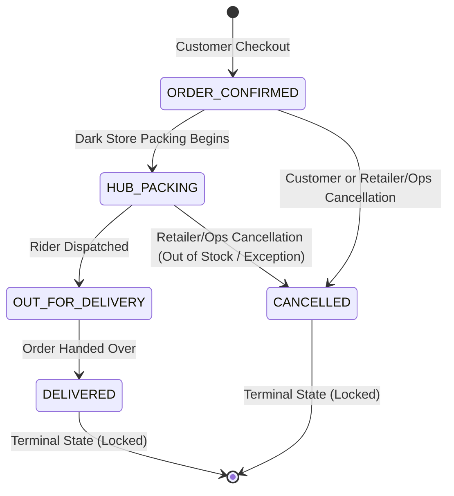

# RasoiIQ — Order Lifecycle & Cancellation Policy Specification
**Document ID:** POL-ORD-2026-622  
**Version:** 1.0 (Hardened)  
**Effective Date:** November 2026  
**Scope:** Customer Web, Retailer Portal, Ops Administration, Backend API  

---

## 1. Canonical State Machine

Orders in RasoiIQ follow a deterministic state machine managed in PostgreSQL (`Order` and `OrderStatusHistory` tables):

---

## 2. Order Status Definitions

| Status | Description | User Persona View | Transitions Allowed |
| :--- | :--- | :--- | :--- |
| **`ORDER_CONFIRMED`** | Order created, inventory verified, payment recorded. | "Order Placed & Confirmed" | `HUB_PACKING`, `CANCELLED` |
| **`HUB_PACKING`** | Retailer dark store picking and packing groceries into carry bags. | "Hub Packing in Progress" | `OUT_FOR_DELIVERY`, `CANCELLED` |
| **`OUT_FOR_DELIVERY`** | Grocery bags picked up by delivery executive. | "Out for Delivery" | `DELIVERED` |
| **`DELIVERED`** | Groceries handed over to household. | "Delivered" | *None* (Terminal State) |
| **`CANCELLED`** | Order terminated before dispatch. | "Cancelled" | *None* (Terminal State) |

---

## 3. Order Cancellation Rules

### 3.1 Customer Self-Service Cancellation
- **Eligible State:** A customer may cancel their order **only** while the order is in `ORDER_CONFIRMED` status.
- **Ineligible States:** Once an order transitions to `HUB_PACKING`, `OUT_FOR_DELIVERY`, or `DELIVERED`, self-service customer cancellation is strictly prohibited. If attempted, the API responds with HTTP 400 Bad Request:
  > *"Customer order cancellation is only permitted when the order is in ORDER_CONFIRMED status. Current status is \"HUB_PACKING\". Please contact customer support for assistance."*
- **Ownership Verification:** A customer can cancel an order only if `order.householdId` matches `currentUser.householdId`. Cross-household cancellation attempts are rejected with HTTP 403 Forbidden.
- **Mandatory Reason:** A cancellation reason (`statusReason`) of at least 3 non-whitespace characters is strictly required.

### 3.2 Retailer / Ops / Staff Cancellation
- **Eligible States:** Retailers and Operations staff may cancel an order during `ORDER_CONFIRMED` or `HUB_PACKING` (e.g. stock shortfall or unexpected hub closure).
- **Ineligible States:** Retailers cannot cancel once `OUT_FOR_DELIVERY` or `DELIVERED`.
- **Retailer Isolation:** Retailer accounts can modify or cancel only orders assigned to their own retailer ID (`order.retailerId === userRetailerId`).

### 3.3 Terminal State Immutability
- Orders in `CANCELLED` or `DELIVERED` status are terminal.
- Reopening or transitioning terminal orders to any other state is strictly forbidden by state machine validation.

---

## 4. Role Authorization Matrix

| Actor Role | Self-Cancellation Window | Advance Fulfillment Status | Access Other Households |
| :--- | :--- | :--- | :--- |
| **`CUSTOMER`** | `ORDER_CONFIRMED` only | ❌ Strictly Forbidden (HTTP 403) | ❌ Strictly Forbidden (HTTP 403) |
| **`RETAILER`** | `ORDER_CONFIRMED` or `HUB_PACKING` | ✅ Authorized (Own orders only) | ❌ Restricted to own retailer orders |
| **`OPERATIONS` / `ADMIN`** | Any active status pre-dispatch | ✅ Authorized | ✅ Authorized |
| **`SYSTEM_WORKER`** | N/A | ✅ Authorized via simulation header | N/A |

---

## 5. Demonstration Disclosures & Transparency

1. **Delivery Simulation:** Because local instances run without commercial quick-commerce logistics fleet integration, all delivery progression is labeled as simulated demonstration.
2. **Delivery ETA:** Displayed delivery windows (e.g., "10-15 mins" or "Same Day 2-4 hrs") are disclosed as simulation demonstrations and do not represent contractual delivery SLAs.
